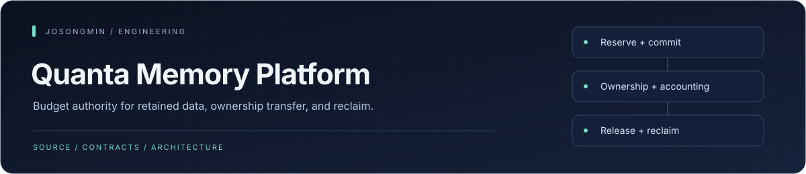
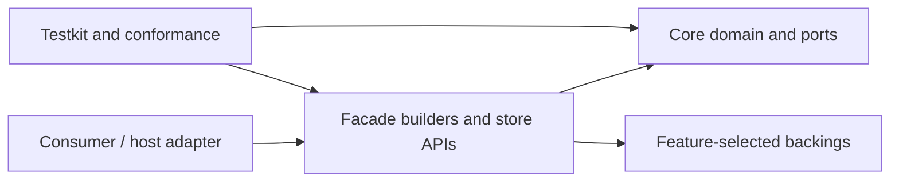

<p align="center"></p>

# Quanta Memory Platform

<p align="center"><a href="#engineering-highlights">Engineering</a> · <a href="#architecture">Architecture</a> · <a href="#start-with-the-builder">Get started</a> · <a href="#documentation">Reference</a></p>

A portable Rust library for **semantic memory budgeting, accounting, and lifecycle control**. A host decides what data means; QMP decides whether retaining it is admissible and tracks the authority to retain, transfer, and release it.

[Use cases](docs/product/use-cases.md) · [Architecture decisions](docs/adr/README.md) · [Migration](MIGRATION.md) · [Verification contract](docs/verification-scenarios.md)

## Engineering highlights

| Mechanism | Engineering purpose | Source |
| :--- | :--- | :--- |
| **Ledger-owned authority** | Budgeted operations reserve and commit accounting authority; allocator telemetry is advisory rather than the source of truth. | [Ledger](crates/quanta-memory-platform-core/src/domain/ledger.rs) |
| **Fail-closed mutation** | A failed accounting operation leaves the ledger unchanged instead of partially charging or releasing counters. | [Ledger operations](crates/quanta-memory-platform-core/src/domain/ledger/operations.rs) |
| **Ownership and custody** | Class, owner, and context attribution make retained data, ownership transfer, and reclaim explicit contracts. | [Core domain](crates/quanta-memory-platform-core/src/domain/) |
| **Builder-first integration** | Consumers configure the facade through public builders; host adapters remain outside this portable library. | [Public builder](crates/quanta-memory-platform-facade/src/shared/builder.rs) |
| **Feature-scoped stores** | Payload, retained-map, revocable, transcript, and publication slices can be selected without adopting durable disk backing. | [Feature gates](crates/quanta-memory-platform-facade/Cargo.toml) |

## Architecture

<a id="architecture-at-a-glance"></a>



Dependency direction is `core <- facade <- testkit`; no package depends on a host. The Semantica adapter lives outside this repository. Existing `MemoryClass` labels such as `MemoResidency`, `PtaResumeState`, and `IdeWorkingSet` are ledger keys and preset weights, not embedded host algorithms. Portable-taxonomy work remains a separate RFC target.

## What QMP owns

| Area | Contract |
| --- | --- |
| Admission | Global/class/owner budgets, scratch/headroom, reserved/soft/hard caps, resource groups, and bounded shared borrowing |
| Accounting | Atomic reserve, commit, release, recharge, and restore; rejected mutations leave accounting unchanged |
| Retention | Payloads, retained maps, revocable stores, prepared publication, and transcripts use the same broker |
| Pressure | Reclaim callbacks run outside the broker lock; hard-cap admission retries at most once after remeasurement |
| Transfer | In-process ownership transfer preserves accounting authority |
| Verification | Conformance fakes, deterministic failures, allocation tracking, Loom models, and feature/extraction checks |

QMP is not an allocator, RSS limiter, or general-purpose database. Allocator telemetry is advisory; the semantic ledger is authoritative. `Context` is an overflow-checked accounting bucket, not a hard context cap. Reclaim rungs are host hints, not a broker-executed eviction ladder.

## Start with the builder

Construct the facade rather than a raw ledger or broker:

```rust
use quanta_memory_platform_facade::{MemoryPlatformBuilder, PortableMemoryPresets};

fn main() -> Result<(), quanta_memory_platform_core::MemoryError> {
    let platform = MemoryPlatformBuilder::new()
        .with_manifest(PortableMemoryPresets::development())
        .build()?;

    // Create budgeted stores from this one platform/ledger.
    // let store = platform.payload_store_builder::<PayloadRef, Vec<u8>>().build()?;
    Ok(())
}
```

`build_report_only()` returns the effective budget report without creating runtime or accounting authority.

Runnable examples:

```sh
cargo run -p quanta-memory-platform-facade --example hello_world
cargo run -p quanta-memory-platform-facade --example effective_budget_report
cargo run -p quanta-memory-platform-facade --features core-live-accounting --example managed_charge_lifecycle
cargo run -p quanta-memory-platform-facade --features core-live-accounting,retained_map,revocable_store --example shared_budget_reclaim
cargo run -p quanta-memory-platform-facade --features transcript --example transcript_session
```

## Choose the required features

| Feature | Surface |
| --- | --- |
| `payload_store` | Canonical retained payloads |
| `retained_map` | Typed retained key/value map |
| `revocable_store` | FIFO reclaimable store |
| `transcript` | Session handles, bounded pages, replay evidence, and explicit retirement |
| `publish_pipeline` | Prepared publication with caller-owned canonical roots |
| `spill` | Portable in-process spill contracts |
| `full` | All in-memory facade slices; no durable backing |
| `spill-durable` | Existing optional durable protocol/restore API; no disk backing |
| `spill-redb` | Existing optional Redb backing; maintenance scope |
| `full-backings` | Existing aggregate including Redb; not a current release target |

Default features enable live accounting. `unbudgeted-stores` is a distinct product type for fixtures or deliberate non-accounted use, excluded from default/full/full-backings. `--all-features` exercises it as an isolated surface.

## Bounds and lifecycle details

Zero-byte tickets still carry single-use authority. Ticket count, identifier size, and deferred cleanup therefore have independent bounds: `MAX_LIVE_TICKETS_PER_BROKER`, 256 UTF-8 bytes per owner/resource-group identifier, and `MAX_DEFERRED_TICKET_DRAIN_BATCH` per broker-lock acquisition.

Payload/metadata totals are semantic charge buckets for owned lifetime components, not per-field physical-byte telemetry. Prepared publication uses separate leases for active payload and persistent identity/index/tombstone evidence. An aborted entry can retain metadata-only authority. Orphan/GC reference-root input is bounded at 16,384 tokens, including duplicates, before acquiring the state lock.

## Checks and integration

```sh
just check
just in-memory
scripts/check-workspace.sh
scripts/check-workspace.sh --in-memory
scripts/extract-to-standalone-repo.sh --dry-run /path/to/qmp-extracted
```

The full script is the repository-local static, contract, feature, dependency, and test authority. The shorter in-memory rail excludes Redb and does not qualify standalone extraction. Scaling commands and evidence policies are documented in [verification scenarios](docs/verification-scenarios.md).

CircleCI's normal workflow verifies a clean standalone extraction, the extracted workspace, and public examples. Confirm the exact SHA and live binding with `python3 scripts/verify-hosted-ci-binding.py`; configuration alone does not prove execution. Heavy scaling receipts are opt-in and are separate from an approved regression baseline or service SLO.

## Status and boundaries

The workspace is pre-1.0 (`0.2.0`, `publish = false`, `UNLICENSED`). Public source visibility does not change its license or registry-publication status.

The active product scope is **in-memory accounting and reclaim**. Durable Redb spill, its codec, and disk/power-loss qualification are excluded from the current QMP/SDK/Semantica plan. Existing optional code is retained as maintenance scope and is not a production-qualified capability. Reopen that work only for a named consumer with a measured benefit and an owned recovery/invalidation contract.

Consumer integration, deployment, and activation are separate from library-local checks. Standalone extraction is described in [EXTRACTION.md](EXTRACTION.md).

## Documentation

- [Consumer use cases](docs/product/use-cases.md)
- [Architecture and custody decisions](docs/adr/README.md)
- [Breaking changes](MIGRATION.md)
- [Change inventory](CHANGELOG.md)
- [QMP/host authority map](docs/ssot/README.md)
- [Plans and remaining work](docs/plans/README.md)

<p align="center"><sub><a href="https://github.com/josongmin">Project map</a> · <a href="#engineering-highlights">Back to overview</a></sub></p>
