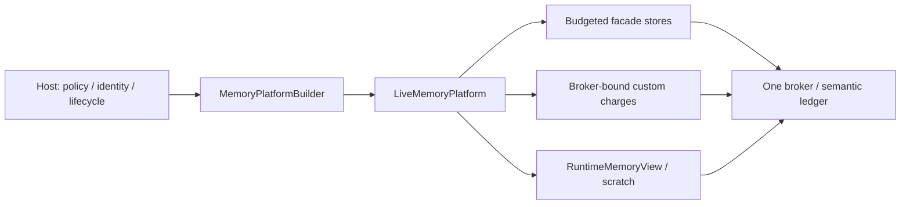

# QMP 유즈케이스와 책임 경계

감사일: 2026-10-06. 소스 기준: `63b31fabae400fdd188547ed9b818b1a38b12269`.
대상: 현재 `0.2.0` portable Rust library, in-memory accounting·reclaim.

이 문서는 **누가, 어떤 상황에서, 무엇을 위해 QMP를 사용하는가**의 단일 진입점이다.
아래 사용자는 소비자 역할의 예시이며 해당 제품에 이미 배포됐다는 뜻이 아니다.
동작의 권위는 현재 소스와 [ADR](../adr/README.md), 테스트 목록은
[verification scenarios](../verification-scenarios.md), API 이행은
[MIGRATION](../../MIGRATION.md)에서 확인한다. 이 문서는 새 기능·IR·release receipt를 만들지 않는다.

## 1. 라이브러리가 해결하는 문제

여러 runtime·owner·store가 같은 budget domain에서 데이터를 보유할 때,
**보유를 허용할지 결정하고, 한 ledger에 귀속시키고, 소유 수명이 끝나거나 이전될 때
정확한 charge authority를 반환·이전한다.**

예를 들어 query worker의 임시 작업 공간, artifact payload, memo entry, session transcript가
하나의 budget을 공유할 수 있다. QMP는 이 데이터의 의미·유효성·작업 실행을 결정하지 않는다.
호스트가 제공한 policy, identity, semantic cost와 수명 전환을 검증하고 account한다.

### 현재 범위와 상태

| 구분 | 상태 |
| --- | --- |
| 아래 UC01–UC10 | 현재 0.2 구현·공개 계약에 근거한 사용 흐름 |
| `MemoryConfig → MemoryScope → MemoryConsumer` DSL, host-neutral taxonomy | [RFC 0001](../rfcs/0001-sdk-interface-contract.md)의 미구현 0.3 설계 |
| `spill-durable`, `spill-redb`, codec·disk recovery | Opt-in maintenance. 현재 생산용 제품 지원·durability 보장 없음 |
| Host adoption·배포·SLO·hosted CI | 소비자와 운영 환경의 별도 실행 증거 필요 |

현재 API는 facade builder-first이며 dependency 방향은 `core <- facade <- testkit`이다.
`full`은 in-memory 기능을 묶으며 durable API·Redb를 포함하지 않는다.
`unbudgeted-stores`는 명시적으로 account하지 않는 별도 fixture/use 타입이다.

## 2. 유즈케이스 선택

| ID | 사용자 / 발생 상황 | 얻는 결과 | 현재 진입점 |
| --- | --- | --- | --- |
| UC01 | 여러 worker·store가 같은 예산을 사용 | 한 domain의 admission·attribution, 구성만 미리 확인 가능 | `MemoryPlatformBuilder`, `LiveMemoryPlatform` |
| UC02 | Host 자체 index·buffer·memo 구조를 보유 | QMP store 밖의 데이터에도 같은 ledger와 move-only charge 적용 | `reserve_owned`, `PendingReservation`, `ManagedCharge` |
| UC03 | Query·분석 작업이 임시 공간을 사용 | 실행 scratch의 예약·관측·반환 | `attach_runtime`, `RuntimeMemoryView::scratch` |
| UC04 | 같은 artifact payload를 반복 등록하거나 pin | Canonical dedup, 수명에 묶인 reference·charge | `payload_store_builder`, `PayloadStore` |
| UC05 | 키로 조회하는 retained metadata/value를 보유·교체 | Atomic insert/recharge·checked read·정확한 sweep 환급 | `retained_map_store_builder`, `RetainedMapStore` |
| UC06 | 오래된 임시 항목을 버려 capacity를 되찾음 | FIFO reclaim·ledger 재측정 후 제한된 admission 재시도 | `revocable_store_builder`, `MemoryReclaimer` |
| UC07 | 재시도되는 session append와 일부 transcript 조회 | Issued handle, replay evidence, bounded page, 명시적 수명 종료 | `transcript_store_builder`, `SessionTranscriptStore` |
| UC08 | Payload를 먼저 준비하고 host root에서 공개 | Deterministic token, prepare/abort/resolve/GC의 charge custody | `prepared_publication_builder`, `PreparedPublicationService` |
| UC09 | 같은 process 안에서 보유 항목을 tier로 이동 | 원 charge를 유지한 transfer·FIFO restore | `spill_one_into`, `SpillController`, `accept_restored` |
| UC10 | 운영 중 사용량 확인·policy 교체·rebuild | Lock-consistent observation·live-state validation·fence 소유권 | `observe`, `try_live_reconfigure`, `begin_rebuild` |

## 3. 모든 유즈케이스의 공통 계약

- **한 권위:** 같은 domain의 store·scratch·custom charge는 같은 broker를 사용한다.
  별도로 build한 platform 두 개는 각각의 ledger이며 합산 process cap을 만들지 않는다.
- **귀속:** class·owner·context·kind·group projection은 같은 ticket을 설명한다.
  Context는 attribution bucket과 overflow guard이며 독립 hard cap·권한·session incarnation이 아니다.
  현재 `MemoryClass`의 host-origin 이름은 ledger key이며 host 알고리즘 구현이 아니다.
- **비용:** `ByteSized`와 `semantic_cost_v1`의 retained cost는 선언된 semantic lifetime 비용이다.
  Store는 admission 때 비용을 고정하고 그 charge를 반환한다. Mutable 값의 비용 변경은
  적절한 replace/recharge와 결합해야 한다. Payload/metadata 통계는 lease별 bucket이다.
- **거부:** accounting mutation은 전체 postimage를 적용하거나 기존 상태를 유지한다.
  Capacity·closed·busy·invalid identity·accounting 오류를 성공·empty·새 session으로 변환하지 않는다.
  Host callback 내부의 임의 부작용까지 rollback한다는 보장은 없다.
- **수명:** lease·rollback receipt·read pin이 실제 보유 기간을 따라야 한다.
  반환된 caller-owned clone, transient canonicalization, allocator overhead와 RSS는
  store retained accounting으로 자동 측정되지 않는다.
- **정리:** explicit `close`/`release`의 오류를 처리한다. 정상 Drop 경로의 반환과 rebuild 중
  보수적 deferred cleanup은 소유권 계약의 일부다. `mem::forget`, process exit/abort,
  `panic=abort`에서 Drop 실행을 보장하지 않는다.
- **입력 한도:** 0-byte ticket도 authority를 점유한다. Ticket count·identifier 길이,
  transcript open-key/evidence, prepared evidence/root input 등 management 한도는
  byte cap과 독립이다. 이 한도가 RSS 상한이나 caller callback latency를 보장하지 않는다.

## 4. 유즈케이스별 흐름과 실패 계약

### UC01. 여러 구성 요소의 예산을 한 domain에 묶기

- **사용자/트리거:** 서비스 host가 worker, payload, metadata, transcript의 예산을 구성한다.
- **흐름:** manifest/preset/override를 builder에 넣고 `build()`에서 검증·구축한다. 구성 검토만
  필요하면 `build_report_only()`에서 검증·report를 얻는다. Runtime view와 budgeted store builder는
  같은 platform에서 얻는다.
- **결과:** global·class·owner·group·scratch·protected floor 등 해당 admission 축을 함께 검사한다.
  Report-only 결과에는 runtime·accounting authority가 없다.
- **실패/host 의무:** 잘못된 policy를 build 전에 거부한다. Host가 capacity 입력·owner 구분·
  독립 domain 구성을 결정한다. 같은 예산을 공유하려는 구성 요소에 별도 platform을 만들지 않는다.
- **근거:** [facade builder](../../crates/quanta-memory-platform-facade/src/shared/builder.rs),
  [공개 builder/accounting tests](../../crates/quanta-memory-platform-facade/tests/public_api_surface.rs),
  [report example](../../crates/quanta-memory-platform-facade/examples/effective_budget_report.rs).

### UC02. Host 자체 데이터 구조의 보유 비용 account하기

- **사용자/트리거:** index segment·memo row·buffer 같은 host-owned 구조가 QMP 내장 store 밖에서 자란다.
- **흐름:** platform의 live broker에서 `reserve_owned(...)`로 pending authority를 얻고,
  실제 보유를 게시할 때 `commit()`하여 `ManagedCharge`를 함께 소유한다.
  이미 확정한 비용은 `reserve_managed_charge(...)` 경로를 사용할 수 있다.
  크기·귀속 교체는 `recharge`, 수명 종료는 `release`/Drop과 결합한다.
- **결과:** custom component와 내장 store가 같은 ledger cap을 경쟁한다. Charge는 non-Clone이며
  발급 broker에 묶인다. 내부 preflight의 판정은 예약 authority가 아니며 미래 성공 보장이 아니다.
  별도 public preflight API를 제공하지 않는다.
- **현재 taxonomy:** 기존 `MemoryClass`에 class를 선택하고 owner/context를 귀속시킨다.
  임의 class 등록 API나 host-neutral `MemoryConsumer` registry는 현재 지원하지 않는다.
- **실패/host 의무:** pending 포기는 rollback한다. 정상 recharge denial은 기존 charge를 유지하며
  release 실패도 retry authority를 보존한다. Host는 실제 데이터와 charge의 게시/해제 순서,
  비용 측정·취소·rollback custody를 소유한다. Payload가 남아 있을 때 capacity를 먼저 반환하지 않는다.
  0.3의 `reserve_up_to`/`commit_measured`/`MemoryConsumer`는 현재 API가 아니다.
- **근거:** [owned authority](../../crates/quanta-memory-platform-core/src/api/control.rs),
  [authority operations](../../crates/quanta-memory-platform-core/src/api/control/authority.rs),
  [broker tests](../../crates/quanta-memory-platform-core/src/api/control/tests/cases_01.rs).

### UC03. 실행 임시 공간을 예약하고 반환하기

- **사용자/트리거:** query·static analysis·batch 작업이 scoped temporary workspace를 필요로 한다.
- **흐름:** `attach_runtime`으로 view를 얻고 owner/context를 정한다. `ScratchAllocator`가
  `ScratchRequest`에 대한 `ScratchReservation`을 발급한다. 관측 peak를 기록하고 scope 종료 시 반환한다.
- **결과:** live scratch는 해당 broker의 semantic charge다. `grow_to_observed`는 예약 범위 안의
  peak 기록이며 추가 capacity 확보가 아니다. 작은 후속 관측이 peak를 낮추지 않는다.
- **실패/host 의무:** 예약 초과 관측, 반환 후 관측·double release를 거부한다.
  Host가 실제 scratch allocation과 예약의 수명을 맞춘다. CPU·wall time·query count·graph edge
  limit은 host가 제어한다. QMP가 allocation 자체를 수행하거나 추적하지 않는다.
- **근거:** [runtime port](../../crates/quanta-memory-platform-core/src/api/broker.rs),
  [scratch contract/tests](../../crates/quanta-memory-platform-core/src/ports/scratch.rs),
  [live scratch adapter](../../crates/quanta-memory-platform-core/src/adapters/scratch.rs).

### UC04. 중복 payload 등록과 pin 수명 관리

- **사용자/트리거:** artifact producer가 같은 canonical payload를 반복 등록하고 참조 중 삭제를 막는다.
- **흐름:** `put_canonical`로 store-issued `String` reference를 받는다.
  Concrete store의 pin/unpin으로 사용 중임을 표시하고 `delete_if_unpinned`/close로 종료한다.
- **결과:** 같은 live canonical payload는 같은 reference와 단일 charge를 유지한다.
  삭제 뒤 재등록·다른 store의 reference는 구분되며 stale reference가 새 entry를 수정할 수 없다.
- **실패/host 의무:** pinned delete, foreign/stale mutation, identity 발급 고갈을 거부한다.
  Reference는 process/store-local lookup identity이며 권한 토큰·durable ID가 아니다.
  Host는 reference를 파싱하거나 restart 경계에서 재사용하지 않는다.
  **이 store에는 reference로 payload를 읽는 get/resolve API가 없다.** 조회가 필요한 데이터 흐름은
  별도로 선택한다; UC08의 prepared resolve와 혼동하지 않는다.
- **근거:** [payload port](../../crates/quanta-memory-platform-facade/src/payload_store/mod.rs),
  [pin/reference/charge tests](../../crates/quanta-memory-platform-facade/src/payload_store/service/tests/cases_01.rs),
  [public identity tests](../../crates/quanta-memory-platform-facade/tests/public_api_surface.rs).

### UC05. 키로 조회하는 retained entry를 원자적으로 게시·교체하기

- **사용자/트리거:** host가 memo metadata·retained result·key/value 상태를 공유하고 중복 producer가 경쟁한다.
- **흐름:** bound retained-map builder로 store를 만든다. Checked insert-if-absent로 creator를 결정하고,
  checked read로 값을 확인한다. Replacement는 recharge와 결합하고 remove/sweep/close가 비용을 반환한다.
- **결과:** key·index·value의 semantic cost를 account한다. Atomic insert-if-absent는
  read-then-insert race로 기존 entry를 덮어쓰지 않는다. Enumeration은 key의 deterministic order를 제공한다.
- **실패/host 의무:** checked API에서 absence와 storage/accounting 오류를 구분한다.
  Replacement denial은 기존 entry·charge를 유지한다. Key의 Eq/Hash 법칙과 실제 값 유효성,
  dependency invalidation·TTL·query recomputation은 host가 소유한다. Cache coherence engine으로 사용하지 않는다.
- **근거:** [retained-map port](../../crates/quanta-memory-platform-facade/src/retained_map/mod.rs),
  [owning tests](../../crates/quanta-memory-platform-facade/src/retained_map/service/tests/mod.rs),
  [concurrency/public caller](../../crates/quanta-memory-platform-facade/tests/public_api_surface.rs).

### UC06. 버려도 되는 항목을 reclaim하고 admission 재시도하기

- **사용자/트리거:** reusable temporary data를 보유한 worker가 pressure 또는 capacity denial을 만난다.
- **흐름:** FIFO revocable store에 insert하고 builder의 `with_reclaimer`로 host callback을 설치한다.
  Callback이 `reclaim_one`/`reclaim_until`로 버릴 항목을 제거한다. 공개 `reserve_owned`/
  `reserve_managed_charge` 또는 budgeted store admission에서 broker가 내부적으로 재측정·재시도한다.
  Revocable store를 만들기만 하면 callback에 자동 등록되는 것은 아니다.
- **결과:** release가 실제로 반환한 ledger capacity만 다시 사용할 수 있다.
  Callback의 reported reclaimed bytes는 advisory다. Reclaimer는 broker lock 밖에서 호출한다.
- **실패/host 의무:** terminal denial·blocked 요청에는 reclaim을 호출하지 않는다.
  Hard admission은 reclaim 뒤 최대 한 번 재시도하며 실패하면 오류를 반환한다.
  Reclaim 실패 시 entry/FIFO/charge를 보존한다. Host가 버려도 되는 victim과 대체 작업을 결정한다.
  Same-store callback은 busy를 받을 수 있다. FIFO store에는 key lookup API가 없다.
  Reclaim rung은 host hint이며 자동 tier ladder·async wait·최소 회수량·throughput fairness를 보장하지 않는다.
- **근거:** [revocable port](../../crates/quanta-memory-platform-facade/src/revocable_store/mod.rs),
  [reclaim tests](../../crates/quanta-memory-platform-facade/src/revocable_store/service/tests/mod.rs),
  [broker admission](../../crates/quanta-memory-platform-core/src/api/control/admission.rs).

### UC07. Session 재시도·일부 읽기·명시적 retirement

- **사용자/트리거:** conversation/log producer가 append를 재시도하고 긴 session을 나눠 읽으며 종료한다.
- **흐름:** `open_session(caller_id)`의 opaque `SessionHandle`을 producer까지 전달한다.
  Handle+sequence+message identity로 append한다. `read_page` cursor로 같은 version을 읽고,
  필요하면 whole-session selector로 `retain_sequences_if_version`을 수행한다.
  Session 종료는 `retire_session`; store 전체 종료는 close다.
- **결과:** 동명 caller ID로 열린 handle들도 독립 incarnation이다. 열린 handle의 exact replay는
  새 row/charge를 만들지 않는다. Eviction 후에도 identity evidence를 유지한다.
  Retire는 key·active rows·evidence를 함께 반환하고 늦은 옛 handle을 거부한다.
- **실패/host 의무:** 0행 session도 count/key bytes를 점유한다. Row retention과 evidence/open 한도는
  독립이다. Page 한도는 row 수와 active semantic cost이며 caller clone의 RSS/latency 상한이 아니다.
  Zero limit·첫 row가 byte limit보다 큰 요청은 Capacity, foreign/stale cursor는 InvalidState,
  stale CAS는 `StaleSnapshot`이다. 내부 Arc를 잡고 caller Clone이 진행 중인 row의 eviction,
  해당 session의 retire·전체 close는 charge 반환 전에 busy로 거부한다.
  Pin은 in-flight read 종료까지이며 반환된 owned snapshot/page는 charge pin을 보유하지 않는다.
  **Page는 일부 행이고 retain selector는 전체 session의 exact 집합이다.** 한 page의 sequence만
  넘기면 다른 page가 퇴거된다. Cursor version/CAS는 selector 완전성을 보증하지 않는다.
  Host는 session end hook·handle mapping·재시도 horizon을 결정한다. Retire 실패 시 mapping을 유지한다.
  Retired exact retry도 거부하며 문자열을 최신 handle로 자동 라우팅하지 않는다.
- **근거:** [public trait/IR](../../crates/quanta-memory-platform-facade/src/transcript_store/mod.rs),
  [lifecycle/page tests](../../crates/quanta-memory-platform-facade/src/transcript_store/service/tests/lifecycle_paging.rs),
  [retirement negative conformance](../../crates/quanta-memory-platform-testkit/src/conformance/suites/tests/cases_01.rs),
  [runnable public example](../../crates/quanta-memory-platform-facade/examples/transcript_session.rs).

### UC08. Payload 준비와 host root 공개를 분리하기

- **사용자/트리거:** artifact publisher가 재시도 가능한 준비를 수행한 뒤 별도 host table에서 공개한다.
- **흐름:** 안정된 logical identity·canonical key로 `prepare`하고 receipt의 token을 얻는다.
  Host가 자신의 canonical root에 token을 게시한다. `resolve`는 resident prepared payload를 조회한다.
  Abort 또는 host-provided root snapshot에 대한 orphan GC는 active payload를 반환한다.
- **결과:** 같은 identity/key의 32-byte token은 deterministic이다. Fresh prepare에서
  eventual retirement를 포함한 전체 identity evidence 공간을 예약한다. Abort/GC는 새 capacity
  admission 없이 evidence를 aborted 상태로 보존하고 active charge만 반환한다. Evidence는 close까지 남는다.
- **실패/host 의무:** identity conflict, aborted/unknown token, evidence 포화와 과대 root input을 거부한다.
  **QMP에 commit API·host root registry는 없다.** Host는 공개 root와 아직 terminal 처리하지 않은
  outstanding prepare를 포함한 완전하고 안정된 보호 집합을 GC에 제공하고, 그 snapshot과 root 게시·
  제거·outstanding 전환을 직렬화한다. 보호 집합에서 빠진 live token은 GC 대상이다.
  Deterministic token 재계산은 process restart 후 resident payload/evidence 복구 보장이 아니다.
  TTL·epoch·token salt로 evidence를 자동 만료시키지 않는다.
- **근거:** [prepared lifecycle](../../crates/quanta-memory-platform-facade/src/publish_pipeline/prepared_publication.rs),
  [upfront evidence admission](../../crates/quanta-memory-platform-facade/src/publish_pipeline/prepared_publication/prepare.rs),
  [owning tests](../../crates/quanta-memory-platform-facade/src/publish_pipeline/prepared_publication/tests/mod.rs),
  [host custody boundary](../adr/0004-host-adoption-boundary.md).

### UC09. In-process tier 사이에서 charge custody 이전하기

- **사용자/트리거:** revocable store의 항목을 같은 process의 retaining tier에 보관했다가 되돌린다.
- **흐름:** `spill_one_into`가 entry와 charge를 소유한 handle을 검증된 in-process controller로 이전한다.
  `restore()`가 oldest handle을 반환하면 `accept_restored(handle)`로 source에 재수용한다.
- **결과:** Source에서 사라져도 target이 payload를 보유하면 같은 charge가 살아 있다.
  Source close가 target의 live charge를 환급하지 않는다. In-process spill은 메모리를 해제하는
  disk offload가 아니므로 이 transfer만으로 전체 ledger headroom이 증가하지 않는다.
- **실패/host 의무:** `spill_one_into`의 destination 실패는 controller가 반환한 원 handle·charge를
  source FIFO에 복원하고 host에는 오류를 반환한다. `accept_restored` 실패는 caller에게 charged
  handle을 `SpillFailure`로 돌려준다. Restore는 정상 empty일 때 `None`, retaining tier의 read 불가일 때
  오류다. Foreign broker/store로의 adoption과 closed-source 수용은 거부한다.
  Host는 수용 실패로 돌아온 handle의 후속 custody를 처리한다.
  Noop/discard의 기본 `None`은 복구 가능한 retaining 성공의 증거가 아니다.
- **근거:** [spill contracts](../../crates/quanta-memory-platform-facade/src/spill/mod.rs),
  [in-process transfer/restore tests](../../crates/quanta-memory-platform-facade/src/revocable_store/service/spill.rs),
  [offline/empty tests](../../crates/quanta-memory-platform-facade/src/spill/service.rs).

### UC10. 운영 관측·live policy 변경·rebuild fencing

- **사용자/트리거:** operator가 capacity를 변경하거나 host가 rebuild 동안 mutation을 제한한다.
- **흐름:** `observe()`로 한 broker의 lock-consistent 정책/사용량을 얻는다.
  `try_live_reconfigure`는 현재 live attribution을 새 policy로 검증한 뒤 적용한다.
  Rebuild는 move-only fence를 발급하고 소유자가 finish/receipt를 처리한다.
- **결과:** 새 설정이 미래 reserve뿐 아니라 기존 ticket도 만족해야 한다.
  0-byte pending/committed ticket도 class authority다. Rebuild 중 committed Drop은
  정확한 authority를 보존하며 보수적으로 charged 상태로 남을 수 있다.
- **실패/host 의무:** invalid live reconfigure·competing/잘못된 fence·observation 오류를 거부한다.
  `finish` 없이 Fence를 Drop하면 abandoned 상태와 mutation 거부를 남긴다. Host는
  `rebuild_fence_status`를 확인하고 `begin_rebuild`로 재인수해 finish한다.
  Finish receipt의 fence-open 결과와 deferred-drain 결과는 별도로 처리한다.
  Drain 오류는 fence를 다시 닫지 않는다. Deferred committed release의 재시도는 다음에 수락된
  fence finish로 수행하며, live reconfigure의 cleanup 재시도는 pending rollback만 처리한다.
  Poison/corruption을 zero snapshot으로 바꾸지 않는다. Host는 통계 수집·경보·fence 완료를 소유하고
  independently sampled report를 atomic observation으로 표시하지 않는다.
  Metrics/allocator probes는 advisory이며 ledger admission·semantic pressure를 덮어쓰지 않는다.
- **근거:** [observation](../../crates/quanta-memory-platform-core/src/api/control/observation.rs),
  [fence/lease types](../../crates/quanta-memory-platform-core/src/api/control.rs),
  [live class authority regression](../../crates/quanta-memory-platform-core/src/api/control/tests/live_class_authority.rs),
  [ledger/policy contracts](../adr/0001-portable-accounting-authority.md).

## 5. 소비자가 확인할 acceptance

위 유즈케이스를 제품에 채택할 때 다음을 실제 consumer 경로에서 관측한다.
Owning unit test 이름이나 library compile 성공으로 제품 실행을 대체하지 않는다.

| 경계 | 필요한 관측 |
| --- | --- |
| Domain 연결 | 사용 store·scratch·custom component가 Cargo-resolved 같은 QMP revision과 같은 broker domain 사용 |
| Admission/오류 | 실제 caller에서 typed denial, 거부 후 content/identity/charge 보존, 환급 후 readmission |
| 수명/취소 | Producer end·cancel·replace·rollback·close에서 실제 data와 charge custody가 일치 |
| 동시성 | 실제 handle·read/CAS·root/GC fence를 사용하는 caller; caller callback과 host lock 순서 확인 |
| 관측 | Ledger projection과 component 수명이 일치; semantic charge·allocator/RSS를 분리해 보고 |
| 비용/성능 | 실제 retained cost와 workload를 확인. SLO는 사전 목표치·호환 baseline·반복 실행으로 별도 검증 |

현재의 [검증 카탈로그](../verification-scenarios.md)는 positive/negative owning tests와
broken fake rejection을 연결한다. Source qualification은
[ADR 0003](../adr/0003-source-bound-qualification.md), host adoption은
[ADR 0004](../adr/0004-host-adoption-boundary.md)의 경계를 따른다.
이 문서 작성은 Rust gate·host 실행·CI 성공·성능 측정을 새로 수행했다는 뜻이 아니다.

## 6. QMP에 넣지 않는 책임과 후속 시작 조건

| 요청 | 책임 / 시작 조건 |
| --- | --- |
| Physical allocation·RSS/cgroup·mmap·GPU 메모리의 hard cap | OS/allocator/host. Semantic accounting으로 해당 한도를 주장하지 않음 |
| Query 실행·결과 유효성·cache dependency·tenant authorization | Host. QMP identity/class/context는 권한 또는 알고리즘이 아님 |
| Worker/process/여러 platform의 합산 예산 | Host의 domain composition. Process-local broker가 distributed quota를 제공하지 않음 |
| Session TTL·prepared 자동 history pruning | Host가 retry/visibility horizon을 확정해야 함. 무제한 이력과 자동 만료를 기본 요구로 추가하지 않음 |
| Host-neutral SDK taxonomy·새 public DSL | 실제 소비자 이행이 선택되면 기존 IR/API를 직접 수정. [미구현 RFC](../rfcs/0001-sdk-interface-contract.md)를 현재 유즈케이스와 혼동하지 않음 |
| Disk spill·restart recovery·power-loss 보장 | Named durable consumer·failure model·evidence owner가 생길 때만 별도 범위. [ADR 0002](../adr/0002-store-custody-and-durable-spill.md) |
| 성능 SLO·추가 module 분할·대규모 검증 | 측정 목표·책임 경계의 결함·유효한 회귀가 확인될 때 시작. Generic checklist를 필수 backlog로 바꾸지 않음 |

## 7. 공식 레퍼런스와 QMP에 적용한 판단

확인일: 2026-10-06. 아래는 계약 비교이며 QMP가 해당 라이브러리의 구현·성능·기능을
계승한다는 주장이 아니다. 외부 reference가 local source/ADR의 권위를 대체하지 않는다.

| 공식 자료 | 확인한 패턴 | QMP 적용과 차이 |
| --- | --- | --- |
| [Apache DataFusion MemoryPool](https://docs.rs/datafusion/latest/datafusion/execution/memory_pool/trait.MemoryPool.html) | 보유 데이터의 consumer가 공유 pool에 capacity를 요청하고, 거부 시 회수/오류를 처리. Reservation은 RAII 수명이며 `try_grow` 실패가 예약을 증가시키지 않음 | UC01/UC02/UC06의 shared admission·custody 근거. QMP는 semantic 다축 ledger이고 SQL operator/spill orchestration이 없음. DataFusion의 infallible `grow`를 QMP의 일반 admission 허용으로 옮기지 않음 |
| [Apache Arrow C++ Memory Management](https://arrow.apache.org/docs/cpp/memory.html) | Buffer backing을 실제 MemoryPool로 allocate하며 작은 객체·temporary workspace 등은 다른 allocator를 사용할 수 있음 | Accounting 대상의 경계를 명시할 근거. QMP는 선언된 semantic 비용을 account하며 Arrow-style buffer allocator·물리 allocation 추적을 제공하지 않음 |
| [Rust Reference — Destructors](https://doc.rust-lang.org/reference/destructors.html) | Scope/field의 Drop 순서와 destructor가 실행되지 않는 forget·process termination 경계를 정의 | UC02/UC03의 lease 수명과 공통 cleanup 조건. QMP는 tested unwind/deferred authority를 추가하지만 abort·누락된 Drop에서도 실행되는 cleanup을 보장하지 않음 |

## 8. 문서 소유권

- **이 문서:** 소비자 목표·사용 흐름·QMP/host 책임·현재 지원 범위의 단일 진입점.
- **[README](../../README.md):** 빠른 시작·feature 선택·문서 navigation.
- **[ADR](../adr/README.md):** 권위·accounting·custody·qualification 결정.
- **[Verification scenarios](../verification-scenarios.md):** 세부 테스트 selector와 실행 경로.
- **[RFC 0001](../rfcs/0001-sdk-interface-contract.md):** 미구현 차기 SDK 설계.
- **[Work scope](../plans/README.md):** 후속 시작 조건. 기능 표만 보고 새 필수 작업을 만들지 않는다.

기능/계약을 바꾸면 해당 유즈케이스, owning tests/public examples, ADR 또는 migration을 함께
갱신한다. 새 번호의 IR·중복 use-case 문서·호환 shim을 만들어 의미를 병행하지 않는다.
