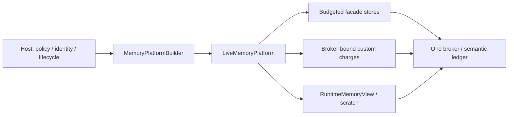
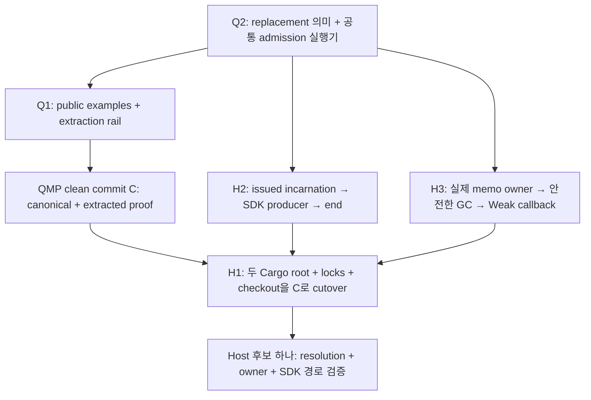

# QMP 유즈케이스와 책임 경계

감사일: 2026-10-06. 소스 기준: `63b31fabae400fdd188547ed9b818b1a38b12269`.
대상: 현재 `0.2.0` portable Rust library, in-memory accounting·reclaim.

이 문서는 **누가, 어떤 상황에서, 무엇을 위해 QMP를 사용하는가**의 단일 진입점이다.
아래 사용자는 소비자 역할의 예시이며 해당 제품에 이미 배포됐다는 뜻이 아니다.
동작의 권위는 현재 소스와 [ADR](../adr/README.md), 테스트 목록은
[verification scenarios](../verification-scenarios.md), API 이행은
[MIGRATION](../../MIGRATION.md)에서 확인한다. 이 문서는 새 기능·IR·release receipt를 만들지 않는다.

## 1. 라이브러리가 해결하는 문제

여러 runtime·owner·store가 같은 budget domain에서 데이터를 보유할 때,
**보유를 허용할지 결정하고, 한 ledger에 귀속시키고, 소유 수명이 끝나거나 이전될 때
정확한 charge authority를 반환·이전한다.**

예를 들어 query worker의 임시 작업 공간, artifact payload, memo entry, session transcript가
하나의 budget을 공유할 수 있다. QMP는 이 데이터의 의미·유효성·작업 실행을 결정하지 않는다.
호스트가 제공한 policy, identity, semantic cost와 수명 전환을 검증하고 account한다.

### 현재 범위와 상태

| 구분 | 상태 |
| --- | --- |
| 아래 UC01–UC10 | 현재 0.2 구현·공개 계약에 근거한 사용 흐름 |
| `MemoryConfig → MemoryScope → MemoryConsumer` DSL, host-neutral taxonomy | [RFC 0001](../rfcs/0001-sdk-interface-contract.md)의 미구현 0.3 설계 |
| `spill-durable`, `spill-redb`, codec·disk recovery | Opt-in maintenance. 현재 생산용 제품 지원·durability 보장 없음 |
| Host adoption·배포·SLO·hosted CI | 소비자와 운영 환경의 별도 실행 증거 필요 |

현재 API는 facade builder-first이며 dependency 방향은 `core <- facade <- testkit`이다.
`full`은 in-memory 기능을 묶으며 durable API·Redb를 포함하지 않는다.
`unbudgeted-stores`는 명시적으로 account하지 않는 별도 fixture/use 타입이다.

## 2. 유즈케이스 선택

| ID | 사용자 / 발생 상황 | 얻는 결과 | 현재 진입점 |
| --- | --- | --- | --- |
| UC01 | 여러 worker·store가 같은 예산을 사용 | 한 domain의 admission·attribution, 구성만 미리 확인 가능 | `MemoryPlatformBuilder`, `LiveMemoryPlatform` |
| UC02 | Host 자체 index·buffer·memo 구조를 보유 | QMP store 밖의 데이터에도 같은 ledger와 move-only charge 적용 | `reserve_owned`, `PendingReservation`, `ManagedCharge` |
| UC03 | Query·분석 작업이 임시 공간을 사용 | 실행 scratch의 예약·관측·반환 | `attach_runtime`, `RuntimeMemoryView::scratch` |
| UC04 | 같은 artifact payload를 반복 등록하거나 pin | Canonical dedup, 수명에 묶인 reference·charge | `payload_store_builder`, `PayloadStore` |
| UC05 | 키로 조회하는 retained metadata/value를 보유·교체 | Atomic insert/recharge·checked read·정확한 sweep 환급 | `retained_map_store_builder`, `RetainedMapStore` |
| UC06 | 오래된 임시 항목을 버려 capacity를 되찾음 | FIFO reclaim·ledger 재측정 후 제한된 admission 재시도 | `revocable_store_builder`, `MemoryReclaimer` |
| UC07 | 재시도되는 session append와 일부 transcript 조회 | Issued handle, replay evidence, bounded page, 명시적 수명 종료 | `transcript_store_builder`, `SessionTranscriptStore` |
| UC08 | Payload를 먼저 준비하고 host root에서 공개 | Deterministic token, prepare/abort/resolve/GC의 charge custody | `prepared_publication_builder`, `PreparedPublicationService` |
| UC09 | 같은 process 안에서 보유 항목을 tier로 이동 | 원 charge를 유지한 transfer·FIFO restore | `spill_one_into`, `SpillController`, `accept_restored` |
| UC10 | 운영 중 사용량 확인·policy 교체·rebuild | Lock-consistent observation·live-state validation·fence 소유권 | `observe`, `try_live_reconfigure`, `begin_rebuild` |

## 3. 모든 유즈케이스의 공통 계약

- **한 권위:** 같은 domain의 store·scratch·custom charge는 같은 broker를 사용한다.
  별도로 build한 platform 두 개는 각각의 ledger이며 합산 process cap을 만들지 않는다.
- **귀속:** class·owner·context·kind·group projection은 같은 ticket을 설명한다.
  Context는 attribution bucket과 overflow guard이며 독립 hard cap·권한·session incarnation이 아니다.
  현재 `MemoryClass`의 host-origin 이름은 ledger key이며 host 알고리즘 구현이 아니다.
- **비용:** `ByteSized`와 `semantic_cost_v1`의 retained cost는 선언된 semantic lifetime 비용이다.
  Store는 admission 때 비용을 고정하고 그 charge를 반환한다. Mutable 값의 비용 변경은
  적절한 replace/recharge와 결합해야 한다. Payload/metadata 통계는 lease별 bucket이다.
- **거부:** accounting mutation은 전체 postimage를 적용하거나 기존 상태를 유지한다.
  Capacity·closed·busy·invalid identity·accounting 오류를 성공·empty·새 session으로 변환하지 않는다.
  Host callback 내부의 임의 부작용까지 rollback한다는 보장은 없다.
- **수명:** lease·rollback receipt·read pin이 실제 보유 기간을 따라야 한다.
  반환된 caller-owned clone, transient canonicalization, allocator overhead와 RSS는
  store retained accounting으로 자동 측정되지 않는다.
- **정리:** explicit `close`/`release`의 오류를 처리한다. 정상 Drop 경로의 반환과 rebuild 중
  보수적 deferred cleanup은 소유권 계약의 일부다. `mem::forget`, process exit/abort,
  `panic=abort`에서 Drop 실행을 보장하지 않는다.
- **입력 한도:** 0-byte ticket도 authority를 점유한다. Ticket count·identifier 길이,
  transcript open-key/evidence, prepared evidence/root input 등 management 한도는
  byte cap과 독립이다. 이 한도가 RSS 상한이나 caller callback latency를 보장하지 않는다.

## 4. 유즈케이스별 흐름과 실패 계약

### UC01. 여러 구성 요소의 예산을 한 domain에 묶기

- **사용자/트리거:** 서비스 host가 worker, payload, metadata, transcript의 예산을 구성한다.
- **흐름:** manifest/preset/override를 builder에 넣고 `build()`에서 검증·구축한다. 구성 검토만
  필요하면 `build_report_only()`에서 검증·report를 얻는다. Runtime view와 budgeted store builder는
  같은 platform에서 얻는다.
- **결과:** global·class·owner·group·scratch·protected floor 등 해당 admission 축을 함께 검사한다.
  Report-only 결과에는 runtime·accounting authority가 없다.
- **실패/host 의무:** 잘못된 policy를 build 전에 거부한다. Host가 capacity 입력·owner 구분·
  독립 domain 구성을 결정한다. 같은 예산을 공유하려는 구성 요소에 별도 platform을 만들지 않는다.
- **근거:** [facade builder](../../crates/quanta-memory-platform-facade/src/shared/builder.rs),
  [공개 builder/accounting tests](../../crates/quanta-memory-platform-facade/tests/public_api_surface.rs),
  [report example](../../crates/quanta-memory-platform-facade/examples/effective_budget_report.rs).

### UC02. Host 자체 데이터 구조의 보유 비용 account하기

- **사용자/트리거:** index segment·memo row·buffer 같은 host-owned 구조가 QMP 내장 store 밖에서 자란다.
- **흐름:** platform의 live broker에서 `reserve_owned(...)`로 pending authority를 얻고,
  실제 보유를 게시할 때 `commit()`하여 `ManagedCharge`를 함께 소유한다.
  이미 확정한 비용은 `reserve_managed_charge(...)` 경로를 사용할 수 있다.
  크기·귀속 교체는 `recharge`, 수명 종료는 `release`/Drop과 결합한다.
- **Resize 경계:** committed charge의 절대 크기를 원자적으로 교체하며 새 ticket ID를 발급한다.
  감소는 차액을 반환하지만 pending/scratch authority의 resize나 기존 charge의 부분 분할은 아니다.
  `recharge`는 새 reserve의 soft reclaim·hard reclaim/retry 경로를 호출하지 않는다.
- **결과:** custom component와 내장 store가 같은 ledger cap을 경쟁한다. Charge는 non-Clone이며
  발급 broker에 묶인다. 내부 preflight의 판정은 예약 authority가 아니며 미래 성공 보장이 아니다.
  별도 public preflight API를 제공하지 않는다.
- **현재 taxonomy:** 기존 `MemoryClass`에 class를 선택하고 owner/context를 귀속시킨다.
  임의 class 등록 API나 host-neutral `MemoryConsumer` registry는 현재 지원하지 않는다.
- **실패/host 의무:** pending 포기는 rollback한다. 정상 recharge denial은 기존 charge를 유지하며
  release 실패도 retry authority를 보존한다. Host는 실제 데이터와 charge의 게시/해제 순서,
  비용 측정·취소·rollback custody를 소유한다. Payload가 남아 있을 때 capacity를 먼저 반환하지 않는다.
  0.3의 `reserve_up_to`/`commit_measured`/`MemoryConsumer`는 현재 API가 아니다.
- **근거:** [owned authority](../../crates/quanta-memory-platform-core/src/api/control.rs),
  [authority operations](../../crates/quanta-memory-platform-core/src/api/control/authority.rs),
  [broker tests](../../crates/quanta-memory-platform-core/src/api/control/tests/cases_01.rs).

### UC03. 실행 임시 공간을 예약하고 반환하기

- **사용자/트리거:** query·static analysis·batch 작업이 scoped temporary workspace를 필요로 한다.
- **흐름:** `attach_runtime`으로 view를 얻고 owner/context를 정한다. `ScratchAllocator`가
  `ScratchRequest`에 대한 `ScratchReservation`을 발급한다. 관측 peak를 기록하고 scope 종료 시 반환한다.
- **결과:** live scratch는 해당 broker의 semantic charge다. `grow_to_observed`는 예약 범위 안의
  peak 기록이며 추가 capacity 확보가 아니다. 작은 후속 관측이 peak를 낮추지 않는다.
- **실패/host 의무:** 예약 초과 관측, 반환 후 관측·double release를 거부한다.
  Host가 실제 scratch allocation과 예약의 수명을 맞춘다. CPU·wall time·query count·graph edge
  limit은 host가 제어한다. QMP가 allocation 자체를 수행하거나 추적하지 않는다.
- **근거:** [runtime port](../../crates/quanta-memory-platform-core/src/api/broker.rs),
  [scratch contract/tests](../../crates/quanta-memory-platform-core/src/ports/scratch.rs),
  [live scratch adapter](../../crates/quanta-memory-platform-core/src/adapters/scratch.rs).

### UC04. 중복 payload 등록과 pin 수명 관리

- **사용자/트리거:** artifact producer가 같은 canonical payload를 반복 등록하고 참조 중 삭제를 막는다.
- **흐름:** `put_canonical`로 store-issued `String` reference를 받는다.
  Concrete store의 pin/unpin으로 개별 삭제를 막고 `delete_if_unpinned`로 삭제한다.
  `close`는 store 전체를 종료한다.
- **결과:** 같은 live canonical payload는 같은 reference와 단일 charge를 유지한다.
  삭제 뒤 재등록·다른 store의 reference는 구분되며 stale reference가 새 entry를 수정할 수 없다.
- **실패/host 의무:** pinned delete, foreign/stale mutation, identity 발급 고갈을 거부한다.
  Reference는 process/store-local lookup identity이며 권한 토큰·durable ID가 아니다.
  Host는 reference를 파싱하거나 restart 경계에서 재사용하지 않는다.
  **Pin은 개별 delete만 막는다. `close`는 pin count와 관계없이 모든 entry를 해제한다.**
  Host가 사용자의 수명과 store 종료를 조정해야 하며 pin을 store-close 방지 lease로 취급하지 않는다.
  **이 store에는 reference로 payload를 읽는 get/resolve API가 없다.** 조회가 필요한 데이터 흐름은
  별도로 선택한다; UC08의 prepared resolve와 혼동하지 않는다.
- **근거:** [payload port](../../crates/quanta-memory-platform-facade/src/payload_store/mod.rs),
  [pin/reference/charge tests](../../crates/quanta-memory-platform-facade/src/payload_store/service/tests/cases_01.rs),
  [public identity tests](../../crates/quanta-memory-platform-facade/tests/public_api_surface.rs).

### UC05. 키로 조회하는 retained entry를 원자적으로 게시·교체하기

- **사용자/트리거:** host가 memo metadata·retained result·key/value 상태를 공유하고 중복 producer가 경쟁한다.
- **흐름:** bound retained-map builder로 store를 만든다. Checked insert-if-absent로 creator를 결정하고,
  checked read로 값을 확인한다. Replacement는 recharge와 결합하고 remove/sweep/close가 비용을 반환한다.
- **결과:** key·index·value의 semantic cost를 account한다. Atomic insert-if-absent는
  read-then-insert race로 기존 entry를 덮어쓰지 않는다. Enumeration은 key의 deterministic order를 제공한다.
- **실패/host 의무:** checked API에서 absence와 storage/accounting 오류를 구분한다.
  Replacement denial은 기존 entry·charge를 유지한다. Key의 Eq/Hash 법칙과 실제 값 유효성,
  dependency invalidation·TTL·query recomputation은 host가 소유한다. Cache coherence engine으로 사용하지 않는다.
- **근거:** [retained-map port](../../crates/quanta-memory-platform-facade/src/retained_map/mod.rs),
  [owning tests](../../crates/quanta-memory-platform-facade/src/retained_map/service/tests/mod.rs),
  [concurrency/public caller](../../crates/quanta-memory-platform-facade/tests/public_api_surface.rs).

### UC06. 버려도 되는 항목을 reclaim하고 admission 재시도하기

- **사용자/트리거:** reusable temporary data를 보유한 worker가 pressure 또는 capacity denial을 만난다.
- **흐름:** FIFO revocable store에 insert하고 builder의 `with_reclaimer`로 host callback을 설치한다.
  Callback이 `reclaim_one`/`reclaim_until`로 버릴 항목을 제거한다. 공개 `reserve_owned`/
  `reserve_managed_charge` 또는 새 reservation을 발급하는 store insert admission에서 broker가
  내부적으로 재측정·재시도한다. 기존 charge를 교체하는 `recharge`에는 이 경로가 적용되지 않는다.
  Revocable store를 만들기만 하면 callback에 자동 등록되는 것은 아니다.
- **결과:** release가 실제로 반환한 ledger capacity만 다시 사용할 수 있다.
  Callback의 reported reclaimed bytes는 advisory다. Reclaimer는 broker lock 밖에서 호출한다.
- **실패/host 의무:** terminal denial·blocked 요청에는 reclaim을 호출하지 않는다.
  Hard admission은 reclaim 뒤 최대 한 번 재시도하며 실패하면 오류를 반환한다.
  Revocable store의 `reclaim_one`/`reclaim_until` 자체가 실패하면 해당 operation의 entry/FIFO/charge를
  보존한다. Host callback이 다른 store에서 이미 수행한 부작용까지 broker가 rollback하지 않는다.
  Host가 버려도 되는 victim과 대체 작업을 결정한다.
  Same-store callback은 busy를 받을 수 있다. FIFO store에는 key lookup API가 없다.
  Reclaim rung은 host hint이며 자동 tier ladder·async wait·최소 회수량·throughput fairness를 보장하지 않는다.
- **근거:** [revocable port](../../crates/quanta-memory-platform-facade/src/revocable_store/mod.rs),
  [reclaim tests](../../crates/quanta-memory-platform-facade/src/revocable_store/service/tests/mod.rs),
  [broker admission](../../crates/quanta-memory-platform-core/src/api/control/admission.rs).

### UC07. Session 재시도·일부 읽기·명시적 retirement

- **사용자/트리거:** conversation/log producer가 append를 재시도하고 긴 session을 나눠 읽으며 종료한다.
- **흐름:** `open_session(caller_id)`의 opaque `SessionHandle`을 producer까지 전달한다.
  Handle+sequence+message identity로 append한다. `read_page` cursor로 같은 version을 읽고,
  필요하면 whole-session selector로 `retain_sequences_if_version`을 수행한다.
  Session 종료는 `retire_session`; store 전체 종료는 close다.
- **결과:** 동명 caller ID로 열린 handle들도 독립 incarnation이다. 열린 handle의 exact replay는
  새 row/charge를 만들지 않는다. Eviction 후에도 identity evidence를 유지한다.
  Retire는 key·active rows·evidence를 함께 반환하고 늦은 옛 handle을 거부한다.
- **실패/host 의무:** 0행 session도 count/key bytes를 점유한다. Row retention과 evidence/open 한도는
  독립이다. Page 한도는 row 수와 active semantic cost이며 caller clone의 RSS/latency 상한이 아니다.
  Zero limit·첫 row가 byte limit보다 큰 요청은 Capacity, foreign/stale cursor는 InvalidState,
  stale CAS는 `StaleSnapshot`이다. 내부 Arc를 잡고 caller Clone이 진행 중인 row의 eviction,
  해당 session의 retire·전체 close는 charge 반환 전에 busy로 거부한다.
  Pin은 in-flight read 종료까지이며 반환된 owned snapshot/page는 charge pin을 보유하지 않는다.
  **Page는 일부 행이고 retain selector는 전체 session의 exact 집합이다.** 한 page의 sequence만
  넘기면 다른 page가 퇴거된다. Cursor version/CAS는 selector 완전성을 보증하지 않는다.
  Host는 session end hook·handle mapping·재시도 horizon을 결정한다. Retire 실패 시 mapping을 유지한다.
  Retired exact retry도 거부하며 문자열을 최신 handle로 자동 라우팅하지 않는다.
- **근거:** [public trait/IR](../../crates/quanta-memory-platform-facade/src/transcript_store/mod.rs),
  [lifecycle/page tests](../../crates/quanta-memory-platform-facade/src/transcript_store/service/tests/lifecycle_paging.rs),
  [retirement negative conformance](../../crates/quanta-memory-platform-testkit/src/conformance/suites/tests/cases_01.rs),
  [runnable public example](../../crates/quanta-memory-platform-facade/examples/transcript_session.rs).

### UC08. Payload 준비와 host root 공개를 분리하기

- **사용자/트리거:** artifact publisher가 재시도 가능한 준비를 수행한 뒤 별도 host table에서 공개한다.
- **흐름:** 안정된 logical identity·canonical key로 `prepare`하고 receipt의 token을 얻는다.
  Host가 자신의 canonical root에 token을 게시한다. `resolve`는 resident prepared payload를 조회한다.
  Abort 또는 host-provided root snapshot에 대한 orphan GC는 active payload를 반환한다.
- **결과:** 같은 identity/key의 32-byte token은 deterministic이다. Fresh prepare에서
  eventual retirement를 포함한 전체 identity evidence 공간을 예약한다. Abort/GC는 새 capacity
  admission 없이 evidence를 aborted 상태로 보존하고 active charge만 반환한다. Evidence는 close까지 남는다.
- **실패/host 의무:** identity conflict, aborted/unknown token, evidence 포화와 과대 root input을 거부한다.
  **QMP에 commit API·host root registry는 없다.** Host는 공개 root와 아직 terminal 처리하지 않은
  outstanding prepare를 포함한 완전하고 안정된 보호 집합을 GC에 제공하고, 그 snapshot과 root 게시·
  제거·outstanding 전환을 직렬화한다. 보호 집합에서 빠진 live token은 GC 대상이다.
  Deterministic token 재계산은 process restart 후 resident payload/evidence 복구 보장이 아니다.
  TTL·epoch·token salt로 evidence를 자동 만료시키지 않는다.
- **근거:** [prepared lifecycle](../../crates/quanta-memory-platform-facade/src/publish_pipeline/prepared_publication.rs),
  [upfront evidence admission](../../crates/quanta-memory-platform-facade/src/publish_pipeline/prepared_publication/prepare.rs),
  [owning tests](../../crates/quanta-memory-platform-facade/src/publish_pipeline/prepared_publication/tests/mod.rs),
  [host custody boundary](../adr/0004-host-adoption-boundary.md).

### UC09. In-process tier 사이에서 charge custody 이전하기

- **사용자/트리거:** revocable store의 항목을 같은 process의 retaining tier에 보관했다가 되돌린다.
- **흐름:** `spill_one_into`가 entry와 charge를 소유한 handle을 검증된 in-process controller로 이전한다.
  `restore()`가 oldest handle을 반환하면 `accept_restored(handle)`로 source에 재수용한다.
- **결과:** Source에서 사라져도 target이 payload를 보유하면 같은 charge가 살아 있다.
  Source close가 target의 live charge를 환급하지 않는다. In-process spill은 메모리를 해제하는
  disk offload가 아니므로 이 transfer만으로 전체 ledger headroom이 증가하지 않는다.
- **실패/host 의무:** `spill_one_into`의 destination 실패는 controller가 반환한 원 handle·charge를
  source FIFO에 복원하고 host에는 오류를 반환한다. `accept_restored` 실패는 caller에게 charged
  handle을 `SpillFailure`로 돌려준다. Restore는 정상 empty일 때 `None`, retaining tier의 read 불가일 때
  오류다. Foreign broker/store로의 adoption과 closed-source 수용은 거부한다.
  Host는 수용 실패로 돌아온 handle의 후속 custody를 처리한다.
  Noop/discard의 기본 `None`은 복구 가능한 retaining 성공의 증거가 아니다.
- **근거:** [spill contracts](../../crates/quanta-memory-platform-facade/src/spill/mod.rs),
  [in-process transfer/restore tests](../../crates/quanta-memory-platform-facade/src/revocable_store/service/spill.rs),
  [offline/empty tests](../../crates/quanta-memory-platform-facade/src/spill/service.rs).

### UC10. 운영 관측·live policy 변경·rebuild fencing

- **사용자/트리거:** operator가 capacity를 변경하거나 host가 rebuild 동안 mutation을 제한한다.
- **흐름:** `observe()`로 한 broker의 lock-consistent 정책/사용량을 얻는다.
  `try_live_reconfigure`는 현재 live attribution을 새 policy로 검증한 뒤 적용한다.
  Rebuild는 move-only fence를 발급하고 소유자가 finish/receipt를 처리한다.
- **결과:** 새 설정이 미래 reserve뿐 아니라 기존 ticket도 만족해야 한다.
  0-byte pending/committed ticket도 class authority다. Rebuild 중 committed Drop은
  정확한 authority를 보존하며 보수적으로 charged 상태로 남을 수 있다.
- **실패/host 의무:** invalid live reconfigure·competing/잘못된 fence·observation 오류를 거부한다.
  `finish` 없이 Fence를 Drop하면 abandoned 상태와 mutation 거부를 남긴다. Host는
  `rebuild_fence_status`를 확인하고 `begin_rebuild`로 재인수해 finish한다.
  Finish receipt의 fence-open 결과와 deferred-drain 결과는 별도로 처리한다.
  Drain 오류는 fence를 다시 닫지 않는다. Deferred committed release의 재시도는 다음에 수락된
  fence finish로 수행하며, live reconfigure의 cleanup 재시도는 pending rollback만 처리한다.
  Poison/corruption을 zero snapshot으로 바꾸지 않는다. Host는 통계 수집·경보·fence 완료를 소유하고
  independently sampled report를 atomic observation으로 표시하지 않는다.
  Metrics/allocator probes는 advisory이며 ledger admission·semantic pressure를 덮어쓰지 않는다.
- **근거:** [observation](../../crates/quanta-memory-platform-core/src/api/control/observation.rs),
  [fence/lease types](../../crates/quanta-memory-platform-core/src/api/control.rs),
  [live class authority regression](../../crates/quanta-memory-platform-core/src/api/control/tests/live_class_authority.rs),
  [ledger/policy contracts](../adr/0001-portable-accounting-authority.md).

## 5. 소비자가 확인할 acceptance

위 유즈케이스를 제품에 채택할 때 다음을 실제 consumer 경로에서 관측한다.
Owning unit test 이름이나 library compile 성공으로 제품 실행을 대체하지 않는다.

| 경계 | 필요한 관측 |
| --- | --- |
| Domain 연결 | 사용 store·scratch·custom component가 Cargo-resolved 같은 QMP revision과 같은 broker domain 사용 |
| Admission/오류 | 실제 caller에서 typed denial, 거부 후 content/identity/charge 보존, 환급 후 readmission |
| 수명/취소 | Producer end·cancel·replace·rollback·close에서 실제 data와 charge custody가 일치 |
| 동시성 | 실제 handle·read/CAS·root/GC fence를 사용하는 caller; caller callback과 host lock 순서 확인 |
| 관측 | Ledger projection과 component 수명이 일치; semantic charge·allocator/RSS를 분리해 보고 |
| 비용/성능 | 실제 retained cost와 workload를 확인. SLO는 사전 목표치·호환 baseline·반복 실행으로 별도 검증 |

현재의 [검증 카탈로그](../verification-scenarios.md)는 positive/negative owning tests와
broken fake rejection을 연결한다. Source qualification은
[ADR 0003](../adr/0003-source-bound-qualification.md), host adoption은
[ADR 0004](../adr/0004-host-adoption-boundary.md)의 경계를 따른다.
이 문서 작성은 Rust gate·host 실행·CI 성공·성능 측정을 새로 수행했다는 뜻이 아니다.

## 6. QMP에 넣지 않는 책임과 후속 시작 조건

| 요청 | 책임 / 시작 조건 |
| --- | --- |
| Physical allocation·RSS/cgroup·mmap·GPU 메모리의 hard cap | OS/allocator/host. Semantic accounting으로 해당 한도를 주장하지 않음 |
| Query 실행·결과 유효성·cache dependency·tenant authorization | Host. QMP identity/class/context는 권한 또는 알고리즘이 아님 |
| Worker/process/여러 platform의 합산 예산 | Host의 domain composition. Process-local broker가 distributed quota를 제공하지 않음 |
| Session TTL·prepared 자동 history pruning | Host가 retry/visibility horizon을 확정해야 함. 무제한 이력과 자동 만료를 기본 요구로 추가하지 않음 |
| Host-neutral SDK taxonomy·새 public DSL | 실제 소비자 이행이 선택되면 기존 IR/API를 직접 수정. [미구현 RFC](../rfcs/0001-sdk-interface-contract.md)를 현재 유즈케이스와 혼동하지 않음 |
| Disk spill·restart recovery·power-loss 보장 | Named durable consumer·failure model·evidence owner가 생길 때만 별도 범위. [ADR 0002](../adr/0002-store-custody-and-durable-spill.md) |
| 성능 SLO·추가 module 분할·대규모 검증 | 측정 목표·책임 경계의 결함·유효한 회귀가 확인될 때 시작. Generic checklist를 필수 backlog로 바꾸지 않음 |

## 7. 공식 레퍼런스와 QMP에 적용한 판단

확인일: 2026-10-06. 아래는 계약 비교이며 QMP가 해당 라이브러리의 구현·성능·기능을
계승한다는 주장이 아니다. 외부 reference가 local source/ADR의 권위를 대체하지 않는다.

| 공식 자료 | 확인한 패턴 | QMP 적용과 차이 |
| --- | --- | --- |
| [Apache DataFusion MemoryPool](https://docs.rs/datafusion/latest/datafusion/execution/memory_pool/trait.MemoryPool.html) | 보유 데이터의 consumer가 공유 pool에 capacity를 요청하고, 거부 시 회수/오류를 처리. Reservation은 RAII 수명이며 `try_grow` 실패가 예약을 증가시키지 않음 | UC01/UC02/UC06의 shared admission·custody 근거. QMP는 semantic 다축 ledger이고 SQL operator/spill orchestration이 없음. DataFusion의 infallible `grow`를 QMP의 일반 admission 허용으로 옮기지 않음 |
| [Apache Arrow C++ Memory Management](https://arrow.apache.org/docs/cpp/memory.html) | Buffer backing을 실제 MemoryPool로 allocate하며 작은 객체·temporary workspace 등은 다른 allocator를 사용할 수 있음 | Accounting 대상의 경계를 명시할 근거. QMP는 선언된 semantic 비용을 account하며 Arrow-style buffer allocator·물리 allocation 추적을 제공하지 않음 |
| [Rust Reference — Destructors](https://doc.rust-lang.org/reference/destructors.html) | Scope/field의 Drop 순서와 destructor가 실행되지 않는 forget·process termination 경계를 정의 | UC02/UC03의 lease 수명과 공통 cleanup 조건. QMP는 tested unwind/deferred authority를 추가하지만 abort·누락된 Drop에서도 실행되는 cleanup을 보장하지 않음 |

### 7.1 기능 커버리지 재감사

2026-10-06, QMP `b4e37960127b715d02baf2b912fd7aa31e95cc51`의 공개 API·실제 구현·owning tests와
공식 레퍼런스를 세 영역에서 병렬로 대조했다. 아래 테스트 근거는 소스를 읽은 결과이며
이 재감사에서 Rust·Cargo·CI·consumer 실행은 **NOT_RUN**이다. 새 회계 결함은 확인하지 못했다.
기능 공백의 존재와 해당 기능을 지금 추가해야 하는지는 별개로 판정한다.

| 비교 기능 | 현재 QMP | 판정 / 소비자 시작 조건 |
| --- | --- | --- |
| 공유 budget·다축 귀속·RAII | 같은 broker의 reserve/commit/release와 class·owner·context·group projection. Pending 포기와 committed Drop의 authority를 보존 | 현재 커버. 새 consumer마다 별도 pool을 만드는 방식으로 합산 cap을 주장하지 않음 |
| 성장·축소·전체 custody 이전 | `ManagedCharge::recharge`는 committed charge의 net postimage를 원자적으로 교체하며 denial 때 old charge 보존. 전체 이전은 Rust move로 가능 | 기본 resize·전체 handoff는 커버. 새 ticket을 발급하는 swap이므로 in-place incremental reservation과 완전히 같지는 않음. Ticket ID 고갈 때 shrink도 거부 가능하며 explicit release는 별도 경로 |
| 성장 중 pressure 처리 | 신규 reserve는 soft callback·hard callback 한 번·재측정. `recharge`는 scheduler/ledger의 atomic replacement를 직접 호출 | 조건부 기능 공백. Mutable component/retained-map의 성장 caller가 다른 store를 회수해 계속 진행해야 할 때 평가 |
| 기존 reservation의 부분 handoff | 같은 owner에 처음부터 여러 charge를 발급할 수 있으나 기존 하나를 추가 byte admission 없이 원자적으로 나누는 API는 없음 | 조건부 기능 공백. 독립 수명의 subobject를 넘기는 caller 필요. Refund-first는 live data를 undercharge하고 reserve-first는 transient double count로 cap에서 거부될 수 있음 |
| 소비자별 공정 배분 | Policy-static group burst share와 live group usage, owner/class/global cap, peer reserved floor를 검사 | 정책 차이. DataFusion의 등록 수 기반 fair fraction과 동등하지 않음. 실제 operator 수 변화·예산 독점 사례 없이 dynamic registry를 추가하지 않음 |
| 현재 상위 owner·denial 진단 | Public `BrokerObservation`의 owner usage에서 top-K를 off-lock 계산 가능. 내부 `LimitBreach`는 구조화됐지만 public `Capacity(String)`에서 해당 필드가 손실 | Top formatter는 편의 기능. 실패 후 별도 `observe()`는 같은 실패 상태를 보장하지 않으므로 machine-readable denial이 필요한 caller에는 final verdict에 묶인 detail이 개선 후보 |
| 전체 peak·측정 구간 | Scratch scope의 observed peak는 있음. Broker 전체·owner별 high-water mark와 구간 reset은 없음 | 측정 기능 공백. Accepted semantic peak 목표가 있으면 최소 scalar부터 평가. 누락 가능한 advisory event나 polling으로 exact peak를 주장하지 않음 |
| Buffer allocation·반환 데이터 수명 | `ByteSized`는 admission-time semantic 비용. Vec/String 기본값은 length이며 allocator capacity가 아님. Map/prepared/transcript의 caller-owned 반환 clone은 store retained charge 밖 | 명시된 범위 차이. 긴 수명 결과를 account하려면 host가 별도 charge와 실제 backing 수명을 결합. 현재 generic read lease/allocator/zero-copy buffer API는 없음 |

근거: [공개 charge authority](../../crates/quanta-memory-platform-core/src/api/control.rs),
[reserve/recharge 경로](../../crates/quanta-memory-platform-core/src/api/control/admission.rs),
[atomic replacement와 floor tests](../../crates/quanta-memory-platform-core/src/api/control/tests/cases_04.rs),
[group scheduler](../../crates/quanta-memory-platform-core/src/application/scheduler.rs),
[observation IR](../../crates/quanta-memory-platform-core/src/domain/stats.rs),
[내부 admission detail](../../crates/quanta-memory-platform-core/src/domain/admission.rs),
[semantic measurement 계약](../../crates/quanta-memory-platform-facade/src/shared/measure.rs),
[read pin/clone tests](../../crates/quanta-memory-platform-facade/src/transcript_store/service/tests/lifecycle_paging.rs).

#### 레퍼런스에서 가져올 때 수정해야 할 가정

- DataFusion docs.rs `latest`는 확인 시 **55.1.0**을 표시했다.
  [MemoryReservation](https://docs.rs/datafusion/latest/datafusion/execution/memory_pool/struct.MemoryReservation.html)의
  `split`/`new_empty`는 같은 consumer registration을 공유한다. QMP는 `OwnerKey`로 여러 charge를
  이미 묶을 수 있으므로 consumer 등록 API의 부재를 accounting 불가로 판정하지 않는다.
- DataFusion FairSpillPool의 분모는 **살아 있는 등록된 spillable consumer 수**이며, 등록 후
  0-byte 상태도 포함한다. `split`/`new_empty`로 분모가 증가하지 않는다. Growth check는 해당
  reservation의 size에 적용되므로 strict consumer-total equal-share라고 표현하지 않는다.
  Pool은 직접 eviction·disk spill·async wait를 수행하지 않는다.
  [공식 55.1.0 구현](https://docs.rs/datafusion-execution/55.1.0/src/datafusion_execution/memory_pool/pool.rs.html).
- [TrackConsumersPool](https://docs.rs/datafusion/latest/datafusion/execution/memory_pool/struct.TrackConsumersPool.html)은
  등록 consumer별 current/peak와 상위 소비자 오류 메시지를 제공한다. Inner pool과 tracker의 업데이트는
  분리되므로 pool 전체·policy와 같은 순간의 snapshot을 보장하는 비교 근거로 쓰지 않는다.
- [PeakRecordingPool](https://docs.rs/datafusion/latest/datafusion/execution/memory_pool/struct.PeakRecordingPool.html)의
  reset은 현재 reserved bytes를 baseline으로 포함한다. 겹치는 query의 수명을 자동 분리한
  per-query peak가 아니다. QMP의 공유 broker에 global reset을 넣기 전에 측정 구간의 owner를 정해야 한다.
- Arrow 공식 문서는 확인 시 **25.0.1**이다. 실제 backing allocator와 shared Buffer slice 수명은
  QMP의 semantic store accounting과 다른 계층이다. 반환 Arc의 backing 전체를 마지막 참조까지
  account하려면 backing에 charge를 묶고 store의 key/index 비용과 중복 계산을 피하는 host 설계가
  필요하다. 이는 가능한 적용 방식이며 현재 내장 read-lease API가 있다는 뜻이 아니다.

### 7.2 후속 후보와 최소 계약

아래는 현재 release gate가 아니라 소비자 요구가 확인될 때의 우선순위다.

1. **구조화 denial:** 실제 caller가 문자열 파싱 없이 제한 축·limit·postimage·policy revision을
   처리해야 하면 기존 `MemoryError`/admission detail을 확장한다. Final locked verdict에서 값을
   확보하고 generic store capacity 오류에 가짜 axis를 만들지 않는다. Top-K 전체 snapshot·정렬을
   reserve hot path에 추가하지 않으며 owner ID를 metric label로 사용하지 않는다.
2. **전체 semantic peak:** Budget tuning/benchmark가 정확한 high-water mark를 요구하면 lifetime
   broker scalar부터 추가한다. 성공한 accounting operation의 최종 postimage에서 기록하고,
   거부된 요청 자체의 미게시 postimage는 기록하지 않는다. 승인되어 ledger에 게시된 pending
   reserve는 이후 rollback되더라도 도달한 lifetime peak에 포함한다. Callback·동시 연산의
   승인된 변동은 별도로 반영하며 deferred charge도 실제 release 전까지 포함한다.
   Owner별 history·global reset·동시 query별 구간은 별도 요구가 없으면 추가하지 않는다.
3. **성장 reclaim:** Pressure에서 진행해야 하는 실제 mutable caller가 있으면 기존 `recharge`에
   net replacement preflight·lock 밖 callback·재검증·최대 한 번 retry를 결합한다.
   Callback 뒤 broker 잠금을 재획득해 old ticket의 유효성, 현재 policy와 group/scratch/headroom을
   포함한 net replacement postimage를 다시 검사하고 같은 잠금 아래 적용한다.
   Denial 때 old charge를 보존한다.
   Retained-map의 store mutation lane은 callback 중에도 잡혀 있으므로 same-store busy·reentry·
   fence/reconfigure 경합과 다른-store victim 성공을 owning negative/positive tests로 고정해야 한다.
4. **부분 split / 동적 policy / 반환 lease:** Subobject handoff·operator 등록 수 변화·반환 backing
   수명이라는 구체적인 caller가 확인될 때만 해당 기존 authority/관측/port를 확장한다.
   부분 split은 단일 broker 잠금 아래 원 charge와 새 charge의 총 byte·class/owner/context/kind/group
   귀속을 보존한다. 추가 ticket 수·ID 고갈·fence 거부에서는 원 charge authority를 그대로 유지한다.
   Public API/examples/conformance를 함께 바꾸며 별도 V2 IR·호환 shim으로 의미를 병행하지 않는다.

추가 운영 관측 후보는 `BrokerObservation`의 pending/committed ticket 분리, deferred cleanup depth,
fence 상태다. 현재 ticket count는 합계이고 fence status/finish cleanup receipt는 별도 API다.
이 차이도 실제 운영 질의가 확인되어야 기존 observation에 추가하며 새 correctness 결함으로 취급하지 않는다.

### 7.3 추가 유즈케이스 감사와 도입 조건

2026-10-06, QMP `79541311434cce918cdfd5546191670769fb0958`에서 consumer authority,
store lifecycle, policy/운영 경계를 세 영역으로 병렬 감사했다. API·구현·owning test 소스를
읽었으며 Rust·Cargo·CI·consumer 실행은 **NOT_RUN**이다. 아래 8개는 앞 절의 후보 외에
검토할 기능이다. 이번 감사에서 도입을 요구하는 실제 caller나 부하 결과는 확인하지 않았다.
기존 API의 의미가 잘못됐다는 판정이나 새 release gate가 아니다.

#### 먼저 소비자 적용에서 확인할 후보

| 후보 | 현재 대안 / 추가할 조건 | 기존 계약에 넣을 최소 변경 |
| --- | --- | --- |
| 상한 예약 후 실측 commit | `reserve_owned(max)` → `commit()` → `recharge(actual)`로 보수적으로 account할 수 있음. 후속 recharge의 fence·ticket ID 거부 때문에 상한 charge가 계속 남는 것이 실제 문제일 때 | 기존 `PendingReservation`에 `actual <= reserved`인 단일 shrink-and-commit 전이. 별도 `MemoryConsumer` 도입 없이 구현 가능. RFC 0001에 이미 제안됐으며 현재 미구현 |
| Retained-map 조건부 교체·삭제 | Immutable entry는 insert-if-absent, mutable entry는 모든 writer가 공유하는 host mutex로 처리 가능. 독립 writer의 read→unconditional insert/remove가 lost update를 만들고 host 직렬화가 불가능할 때 | 기존 retained-map port에 expected value/version 기반 조건부 mutation. `insert_if_absent`는 생성 경쟁만 해결하며 기존 값의 조건부 갱신은 제공하지 않음 |
| Policy revision CAS | 단일 policy owner 또는 모든 writer를 직렬화한 host read/update로 처리 가능. 복수 관리자가 같은 revision을 읽고 전체 policy를 교체해 먼저 적용된 변경을 덮어쓸 때 | 기존 `try_live_reconfigure`에 expected policy revision 검사와 typed conflict. 기존 observation의 revision을 재사용하며 별도 policy IR를 만들지 않음 |

각 후보의 실패 계약:

1. **실측 commit:** 차액 반환과 pending→committed 전이를 같은 broker 잠금에서 적용한다.
   모든 byte/귀속 축·group floor·scratch/headroom·ticket-count 불변식을 유지한다.
   상한 초과·fence·commit 실패 시 value는 게시하지 않는다. RFC의 consuming API를 적용하면
   pending을 rollback하고 cleanup 실패 시 정확한 authority를 deferred retry에 남긴다.
   0-byte commit도 한 ticket을 유지한다. 향후 broker lifetime peak를 도입한다면 상한 pending
   예약의 실제 도달치를 실측 commit의 차액 반환으로 지우지 않는다.
2. **Map 조건부 mutation:** 같은 store mutation lane에서 기대값 확인·net recharge·게시를
   결합한다. Mismatch와 capacity 거부는 old value·charge·순서를 보존한다. 기대값 비교의
   Eq/Hash/Clone panic·reentry를 기존 hostile-trait 경계로 처리한다. ABA를 구분해야 하면
   단순 value equality 대신 host value의 version 계약이 필요하다. 반환 clone의 비용은 별도다.
3. **Policy CAS:** expected revision 비교를 validation/install과 같은 broker 잠금에 둔다.
   호출 전에 별도 `observe()`로 비교하는 것만으로는 race가 사라지지 않는다. Stale conflict는
   policy·revision·scheduler·ledger·epoch를 유지한다. Caller는 최신 policy를 다시 읽고
   자신의 변경을 재합성하며, 이전 전체 policy를 그대로 retry하지 않는다.

근거: [pending/managed authority](../../crates/quanta-memory-platform-core/src/api/control.rs),
[commit/replacement ledger](../../crates/quanta-memory-platform-core/src/domain/ledger/operations.rs),
[기존 실측 commit 설계](../rfcs/0001-sdk-interface-contract.md),
[map port](../../crates/quanta-memory-platform-facade/src/retained_map/mod.rs),
[map 구현](../../crates/quanta-memory-platform-facade/src/retained_map/service.rs),
[live reconfigure](../../crates/quanta-memory-platform-core/src/api/control/observation.rs).
Version으로 stale update를 거부하는 비교 패턴은
[Kubernetes 공식 API 계약](https://kubernetes.io/docs/reference/using-api/api-concepts/#updates-to-existing-resources)에도
있다. 이는 QMP가 Kubernetes의 분산 consistency나 API 기능을 제공한다는 뜻이 아니다.

#### Store 사용 방식이 확인된 뒤 검토할 후보

| 후보 | 현재 대안 / 추가할 조건 | 필요한 경계 |
| --- | --- | --- |
| Payload reference 조회 | 현재 payload store에는 get/resolve가 없음. 처음부터 retained-map 또는 host-owned payload authority를 선택할 수 있음. Deduplicated canonical payload 자체가 읽기 원본이어야 할 때 | 기존 payload port에 issued-reference checked read. Foreign/stale/absence와 read failure를 구분하고 clone panic·close 경합을 처리. 반환 clone은 자동 charge하지 않으며 현재 pin은 close를 막지 않는다는 경계를 명시 |
| 제한된 map 열거 | 현재 keys/entries checked API는 전체 clone 후 잠금 밖에서 정렬. 알려진 key의 point read나 host-owned index로 대체 가능. 큰 map의 전체 복사가 실제 비용일 때 | 기존 port에 row/semantic-byte bound와 mutation-version cursor. 출력 수만 제한한 HashMap scan은 scan/latency 상한이 아님. Ordered index가 필요하면 그 비용과 변경도 같은 fail-closed postimage에 포함 |
| Transcript 일부 sequence 삭제 | 현재 `retain_sequences*`는 session 전체의 keep set. 전체 selector를 만들고 CAS할 수 있고, 앞쪽 N개 보존/뒤쪽 삭제에는 `truncate_to`를 쓸 수 있음. 일부 page만 읽고 그중 선택 항목을 지워야 하며 전체 selector 구축 비용이 클 때 | 기존 port에 expected version을 받는 선택 삭제. 다른 page의 row는 유지. Duplicate/unknown sequence의 의미, stale/foreign 거부, read pin, release-batch 복구, replay evidence 보존, 실제 변경 시 version 증가를 함께 정의 |

Payload pin은 reference metadata이므로 stronger close-blocking lease와 같지 않다.
단순 RAII unpin helper도 closed/poisoned 상태에서 fallible unpin의 성공을 보장하지 못한다.
새 읽기 API를 설계할 때 pin 이름만으로 수명 보장을 추정하지 않는다.

근거: [payload port](../../crates/quanta-memory-platform-facade/src/payload_store/mod.rs),
[payload pin/close 구현](../../crates/quanta-memory-platform-facade/src/payload_store/service.rs),
[map 전체 열거 구현](../../crates/quanta-memory-platform-facade/src/retained_map/service.rs),
[transcript selector port](../../crates/quanta-memory-platform-facade/src/transcript_store/mod.rs),
[paging/read-pin tests](../../crates/quanta-memory-platform-facade/src/transcript_store/service/tests/lifecycle_paging.rs).
[Rust BTreeMap range](https://doc.rust-lang.org/std/collections/struct.BTreeMap.html#method.range)는
정렬된 key 범위를 순회하는 자료구조 예시다. 현재 QMP map은 HashMap이며 자료구조 교체만으로
snapshot paging·accounting·latency 계약이 완성되지는 않는다.

#### 비용이 큰 authority 확장은 후순위

- **동일 backing의 scratch→retained 전이:** 현재는 retained를 먼저 reserve하고 scratch를
  반환할 수 있다. 실제로 같은 allocation을 인계할 때만 이중 charge 없이 단일 잠금에서
  pending scratch→committed retained 전이를 검토한다. 임시 buffer와 새 retained buffer가
  동시에 존재하면 둘 다 charge해야 한다. Denial은 scratch authority를 보존하고 retained를
  게시하지 않는다. 기존 [scratch port](../../crates/quanta-memory-platform-core/src/ports/scratch.rs)와
  authority를 확장하며 allocator 추정이나 refund-first 우회를 넣지 않는다.
- **여러 component의 원자적 admission:** 현재 host-owned custom charge는 개별 pending으로
  stage하고 모두 commit된 뒤 host value를 게시할 수 있다. 서로 다른 facade store mutation까지
  이 방식으로 원자화할 수는 없다. Staging의 임시 점유가 실제 contention 문제가 될 때만
  기존 broker의 batch reserve/commit을 검토한다.
  Staging은 atomic batch가 아니며 중간 commit 실패 시 이미 committed된 lease를 host가
  회수하거나 cleanup이 가능할 때까지 보존해야 한다. Rebuild 중 Drop은 deferred cleanup에 남을 수 있다.
  Mixed-axis postimage·ticket 수·ID·floor를 같은 잠금에서 검사하고 일부 성공을 노출하지 않는다.
  Ticket의 일괄 성공은 host publication까지 자동 transaction으로 만들지 않는다.
  Batch release는 이미 [공개 `release_managed_many`](../../crates/quanta-memory-platform-core/src/api/control/authority.rs)로
  지원하므로 신규 기능으로 다시 넣지 않는다.

#### 기능을 늘리기 전에 가능한 보완

- 공개 custom charge 사용 예제와 `Weak`로 다른 store를 참조하는 reclaimer 예제를 먼저
  보강할 수 있다. Strong capture는 broker→callback→store→broker cycle을 만들 수 있다.
  Safe late wiring은 이미 [cross-store test](../../crates/quanta-memory-platform-facade/tests/cross_store_hellgate.rs)에
  있으므로 새 reclaim registry를 만들 필요는 없다.
- Shared backing과 charge를 같은 host-owned Arc 안에 묶는 방식은 기존 API로 가능하다.
  Private fields에서 value를 charge보다 먼저 두고 charge의 독립 조기 release를 막는다.
  Mutable backing의 비용 변화는 상한 또는 recharge/replace로 account하며 store의 key/index
  비용과 backing charge를 중복 계산하지 않도록 host가 설계한다.
  Generic charged-value helper 부재를 새 core 기능 공백으로 단정하지 않는다.
- `remove`의 old value 반환, batch release, 0-byte FIFO entry의 metadata 비용은 이미 커버한다.
  Session/root registry·TTL/LRU·async wait·분산 예산·durable recovery는 현재 caller 근거 없이
  이 감사에서 신규 필수 작업으로 추가하지 않는다.

도입 시 owning tests와 public examples/conformance를 함께 변경한다. 이 절의 우선순위는
실제 caller가 기존 대안으로 해결되지 않는 경우에만 적용하며 §7.2와 함께 자동 일괄 구현하지 않는다.

### 7.4 최종 작업 목록: 통합 P0와 추가 구현

2026-10-06, QMP `867f96f7d7b389a4ad8344241b1b5d98d55e24cc`와 Semantica
`08c0216a5077f491d6fe2eeb095244249310e129`의 관련 소스를 읽고 실행 범위를 재분류했다.
QMP 작업 트리는 clean이었고 Semantica의 검사한 manifest/lockfile/host/compose/checkout-contract
경로에도 dirty overlay가 없었다. Rust·Cargo resolution·QBC·host·CI 실행은 **NOT_RUN**이다.
이 절이 실행 우선순위의 권위이며 §7.2–7.3은 세부 계약과 조건부 후보의 근거다.

**P0는 요청한 최우선 통합 wave다. 모든 항목이 현재 운영 P0 장애라는 뜻은 아니다.**
QMP 내부 통합, 소비자 cutover, 검증 공백을 구분한다. 필요한 변경은 기존 authority/port/IR를
직접 확장하며 별도 V2 IR·호환 shim·독립 회계 계층을 만들지 않는다.

#### 이미 배선된 경로

- Platform builder→같은 broker→budgeted store/scratch/custom charge는 구현돼 있다.
  `StoreAccounting::charge`도 public managed-charge 경로를 호출한다. 새 factory를 만들지 않는다.
- Builder의 reclaimer/event-sink 설치 seam, 다른 store를 `Weak`로 참조하는 reclaim과
  실제 ledger 재측정은 구현돼 있다. Host가 설치해야 하는 callback까지 자동 등록됐다는 뜻은 아니다.
- Cross-store tests에는 공유 cap 경쟁, scratch/0-byte authority와 live policy, 다른 store 회수,
  mixed charge-kind의 수명 검증이 있다. 테스트 소스의 존재를 이번 실행 성공으로 표시하지 않는다.

근거: [platform builder](../../crates/quanta-memory-platform-facade/src/shared/builder.rs),
[sealed accounting](../../crates/quanta-memory-platform-facade/src/shared/accounting.rs),
[cross-store contracts](../../crates/quanta-memory-platform-facade/tests/cross_store_hellgate.rs).

#### P0 — QMP 라이브러리 통합

| ID | 목적 / 확인된 공백 | 변경할 owner와 완료 조건 |
| --- | --- | --- |
| P0-Q1. Public consumer 흐름과 extraction 배선 | Custom charge 수명과 Weak cross-store reclaim은 API/tests에 있지만 실제 extracted example rail은 scratch/report/transcript 세 예제만 실행 | Facade examples에 custom reserve→commit→recharge→denial 보존→release/Drop, 그리고 다른 store reclaim→재측정→재입장 흐름을 추가. 필요한 feature와 README/EXTRACTION/예제 verifier를 함께 연결. Public imports만 사용하고 별도 raw constructor·registry를 만들지 않음. Clean committed extraction에서 두 흐름을 실제 실행하고 종료 후 ledger/ticket 잔량 검사 |
| P0-Q2. Growth admission에 pressure 경로 연결 | 실제 retained-map overwrite는 `ManagedCharge::recharge`를 호출하지만 신규 reserve의 soft/hard reclaim 경로에 연결되지 않음. Pressure 아래 신규 insert와 growth의 진행 조건이 다름 | Core admission의 replacement preflight와 기존 callback orchestration을 결합. Facade overwrite는 같은 charge API를 유지. 이 작업에는 새 replacement 의미의 구현도 필요하며 단순 함수 forwarding으로 처리할 수 없음. Positive 다른-store 회수 후 성장, negative terminal/blocked·wrong victim·callback panic·fence/reconfigure 경합·same-store busy, old content/authority 보존을 owning tests로 고정 |

P0-Q2의 핵심 계약:

- Old ticket을 제외하고 new attribution을 더한 **net replacement postimage**로 모든 cap,
  group share/floor, scratch/headroom, ticket 수·ID를 검사한다. 전체 byte 감소라도 class/owner/group
  귀속 증가가 있을 수 있으므로 `new_bytes - old_bytes` 하나로 판정하지 않는다.
  단일 replacement의 live-ticket 수는 유지된다. Ticket cap에 도달한 상태에서 신규 reserve의
  count preflight를 그대로 사용해 합법적인 replacement를 거부하지 않는다. ID 고갈은 별도 거부다.
- Callback은 broker 잠금 밖에서 실행하고 hard retry는 최대 한 번이다. Terminal/blocked는
  callback 없이 거부한다. 회수 목표도 제한 축의 부족량과 피해자 범위에 맞추며 full new size를
  새 allocation처럼 double count하지 않는다. Admission에 도움이 되지 않는 단순 shrink에
  불필요한 reclaim을 추가하지 않는다.
- Callback 후 old ticket과 현재 policy의 전체 postimage를 다시 검사하고 같은 broker 잠금에서
  replacement를 적용한다. 실패는 old authority를 유지한다. Callback이 다른 store에서 이미
  수행한 회수까지 rollback하지 않는다. Target store mutation lane의 reentry/busy 계약을 유지한다.
- 구조화 denial의 공개 API 확장(P1-02)은 독립 작업이다. P0-Q2의 내부 verdict를 먼저 정확히
  유지하며 문자열 파싱이나 실패 뒤 새 observation으로 replacement 판정을 복원하지 않는다.

근거: [reserve/recharge admission](../../crates/quanta-memory-platform-core/src/api/control/admission.rs),
[atomic ledger replacement](../../crates/quanta-memory-platform-core/src/domain/ledger/operations.rs),
[실제 map recharge caller](../../crates/quanta-memory-platform-facade/src/retained_map/service.rs),
[현재 extracted example rail](../../scripts/verify-extracted-examples.sh).

#### P0 — Semantica 소비자 cutover와 배선

아래는 **Semantica에서 새 QMP를 사용할 때의 P0**이며 변경 owner는 Semantica다.
Portable QMP의 독립 사용에 host 채택을 강제하지 않는다. 이번 감사에서는 해당 저장소를 수정하지 않았다.

| ID | 현재 소스에서 확인한 상태 | 해야 할 일 / 완료 조건 |
| --- | --- | --- |
| P0-H1. 한 QMP revision으로 cutover | 두 workspace Cargo dependency/metadata, 두 lockfile, external checkout contract는 모두 `14cf0345004d0703c7d32da34055af5367a9212d`에 고정. 최신 QMP가 자동 채택되지 않음 | 먼저 QMP의 최종 코드 candidate C를 qualify. Semantica 두 root의 deps/metadata/lockfile, dependency contract 문서, external checkout/topology/static guards를 C로 함께 이행. Doctor baseline은 새 source inventory와 의미를 검토하며 허용량을 늘려 통과시키지 않음. 두 root의 실제 Cargo-resolved core/facade package IDs와 revision이 동일한 C여야 함 |
| P0-H2. Transcript incarnation/end/read 배선 | Host adapter는 caller key를 append identity·session_bytes·load·retain에 넘기고 open/retire를 호출하지 않음. Compose product port도 문자열 session ID와 full Vec read를 전달. 현재 QMP는 issued `SessionHandle`을 요구 | 기존 host/runtime request IR와 port에 open 결과 handle을 전파하고 append/read/retain/end까지 같은 incarnation을 사용. 문자열→최신 handle 자동 라우팅 금지. End/취소의 retire 실패 시 handle/charge custody 보존. Bounded product read를 제공할 때 QMP page의 row/byte/cursor를 그대로 연결; full Vec convenience를 bounded 경로라고 표시하지 않음. Pinned system prompt는 host 의미로 유지. Exact retry·late old request·retire/reopen·read/retire race를 실제 SDK 경로에서 검증 |
| P0-H3. 실제 reclaimer 설치와 cleanup authority 연결 | 검사한 Semantica Rust 소스에는 `with_reclaimer`/`MemoryReclaimer` 구현이 없음. Lifecycle helper는 `reclaim_one` 뒤 value length를 별도 sink에 전달하며 기본 sink는 누적 counter. 이는 실제 ledger refund 증거가 아님; 발견한 helper caller는 tests | Pressure recovery를 제공할 host bootstrap이 evictable victim/정책을 정하고 기존 builder callback seam에 Weak wiring을 설치. Budgeted store 자체가 lease를 반환하므로 별도 byte-only broker refund 금지. Lifecycle 결과는 semantic swept cost와 실제 ledger projection으로 정의하고 value length를 환급량으로 주장하지 않음. No victim/closed victim/부분 실패에서도 bounded denial과 custody 보존. Helper의 현재 production 실행을 확인한 결함으로 단정하지 않고 활성화 전에 계약을 정리 |

P0-H2는 runtime→host 또는 runtime→QMP의 새 concrete import로 해결하지 않는다.
기존 product port/request IR의 opaque incarnation 계약을 직접 확장하고 compose/host가
실제 QMP handle과 그 수명을 연결한다. Producer가 소유한 incarnation을 end까지 전달하며
host mapping만 최신 handle로 교체해서 늦은 옛 요청을 수용하는 방식은 금지한다.

Semantica 근거 경로는 `Cargo.toml`, `Cargo.lock`, `packages/analysis/quanta-v2/{Cargo.toml,Cargo.lock}`,
`tools/ci/contracts/external-rust-workspaces-v1.toml`,
`docs/ssot/quanta-memory-platform-dependency-contract-v1.md`,
`packages/analysis/quanta-v2/crates/quanta-memory-host/src/{session/transcript_adapter.rs,lifecycle.rs}`,
`packages/analysis/quanta-v2/crates/quanta-runtime-memory-compose/src/session_transcript.rs`,
`packages/analysis/quanta-v2/crates/quanta-runtime/src/sdk/runtime_kernel_core.rs`다.
경로는 소비자 저장소 소유이며 QMP extraction에 복사하거나 host dependency를 추가하지 않는다.

Host 통합의 공통 acceptance에는 root/GC 보호 집합의 완전성·outstanding prepare·게시 직렬화,
returned clone/backing의 비용, cancel/rollback/close custody, observation/typed error 전파도 포함한다.
해당 권한은 이미 host 책임이다. 이번 source pass가 각 제품 경로의 정확성을 실행으로 입증하거나
그 경계에 새 결함을 확인한 것은 아니다. [Host adoption 계약](../adr/0004-host-adoption-boundary.md)을 따른다.

#### P1 — 다음에 추가할 기본 API

| ID / 기능 | 목적 | 현재 대안 / 최소 구현 |
| --- | --- | --- |
| P1-01. 실측 commit | 보수적 상한을 예약한 뒤 실제 보유 크기로 한 번에 확정해 과예약 잔류를 줄임 | 현재 commit 후 recharge. 기존 PendingReservation에 `actual <= reserved` shrink-and-commit. 실패 value 미게시·정확한 rollback/deferred authority·0-byte ticket 유지. RFC에 이미 있으며 새 consumer registry 없이 구현 |
| P1-02. 구조화 denial | Caller가 제한 축·limit·postimage·deficit·policy revision으로 오류/재시도를 판단 | 현재 Capacity(String). 기존 내부 LimitBreach와 공개 MemoryError를 확장해 final locked verdict를 전달. Broker capacity와 store local capacity를 구분하고 overflow의 unrepresentable postimage도 표현. Hot path top-K 정렬·가짜 axis·error-string 파싱 금지 |
| P1-03. Policy revision CAS | 복수 policy writer의 stale 전체 교체 방지 | 현재 단일 host writer/공유 mutex. 기존 revision을 install 잠금에서 비교하고 typed conflict. 실패 policy/report/revision/ledger/scheduler/epoch 유지; 최신 policy에 변경 재합성 |
| P1-04. Map 조건부 교체·삭제 | 독립 writer의 read→write lost update 방지 | 현재 insert-if-absent 또는 모든 writer의 host 직렬화. 기존 port에 expected value/version 조건을 넣고 match→recharge→mutation을 같은 lane에서 수행. Mismatch/denial 보존, ABA·trait panic/reentry와 반환 clone 비용 정의 |

P1-03/04는 복수 writer를 지원하려는 소비자에서 선택한다. 현재 API가 unconditional operation인
사실만으로 existing accounting defect를 선언하지 않는다. 최소 실패 계약은 §7.2–7.3을 유지한다.

#### P2 — 목적이 확인되면 추가할 기능 전체 목록

| ID / 기능 | 목적과 시작 조건 | 현재 대안 / 구현 경계 |
| --- | --- | --- |
| P2-01. 전체 semantic peak | 실제 budget tuning/benchmark에서 정확한 broker lifetime maximum 필요 | Scratch peak/현재 usage는 있음. 성공한 ledger postimage에서 scalar 기록; 승인 pending의 이후 rollback은 peak를 지우지 않음. Owner history/reset/query window는 별도 요구 |
| P2-02. 통합 lifecycle 관측 | Rebuild 지연·deferred backlog·pending/committed 구분이 필요한 운영 질의 | 현재 fence status/finish receipt/총 ticket count를 사용. 기존 BrokerObservation에 같은 잠금의 상태/count 추가. Metrics advisory와 authority를 혼합하지 않음 |
| P2-03. Payload checked read | Canonical dedup store를 실제 읽기 원본으로 사용할 때 | Retained-map/host payload authority를 처음부터 선택 가능. 기존 payload port에 issued-ref read와 absence/failure/foreign/stale 정의. Clone 비용은 caller 책임; pin은 close 방지 lease가 아님 |
| P2-04. Bounded map enumeration | 큰 map에서 전체 clone/sort 비용을 피하는 실제 listing/GC caller | Point read/host index 가능. Version cursor·row/semantic-byte bound. HashMap scan의 출력 cap은 scan/latency cap이 아님; ordered index 비용/atomicity 함께 설계 |
| P2-05. Transcript 선택 삭제 | 일부 page의 특정 row만 지우고 다른 page는 보존 | 전체 keep-set+CAS 가능; truncate_to는 앞쪽 N개 보존. 기존 port에 expected-version evict set, unknown/duplicate 의미, read pin·replay evidence·batch-release rollback·actual-change version 정의 |
| P2-06. Charge 부분 split | 한 charge의 subobject를 서로 독립된 수명으로 handoff | 처음부터 여러 charge/전체 move 가능. 같은 broker lock의 byte/귀속 보존, ticket-count/ID/fence 거부 시 원 authority 유지 |
| P2-07. Scratch→retained 전환 | 실제 동일 backing을 임시 작업에서 장기 보유로 인계 | Retained reserve→scratch release 가능. Host의 same-backing 증명과 단일 pending→committed net 전이. 두 buffer가 공존하면 둘 다 charge |
| P2-08. Atomic batch admission | 여러 custom component를 staging할 때 임시 점유 contention이 실제 문제 | Pending staging+host 미게시 가능. 기존 broker에서 mixed-axis 전체 reserve/commit; host publication transaction까지 자동 제공하지 않음. Batch release는 이미 지원 |
| P2-09. Shared backing/read lease | Returned shared data를 마지막 참조까지 account해야 하며 host wrapper로 해결하기 어려울 때 | Private host Arc(value, charge)로 가능. Value-before-charge와 조기 release 방지, mutable 비용 갱신, store index/backing 중복 계산 방지부터 검증. 실제 필요 시 기존 facade/port 수명 확장 |
| P2-10. Dynamic consumer allocation | 등록 operator 수 변화로 정적 group 배분이 실제 독점/진행 문제를 만들 때 | 현재 owner/group cap·정적 burst/floor. Live registration·0-byte consumer·공유 split의 등록 수·배분 단위를 명시. Host scheduling/throughput fairness와 구분 |
| P2-11. Portable taxonomy/SDK DSL | 새 host가 현재 class enum/인자 묶음 때문에 이행이 막힐 때 | 현재 builder+기존 class/owner/context로 사용 가능. RFC의 기존 IR/API를 직접 수정하고 defaults·exports·feature/API examples·consumer 이행을 함께 수행. 새 DSL 전체를 P0에 묶지 않음 |

#### 별도 요구 전까지 구현 대상으로 잡지 않는 범위

- Async capacity wait/admission queue는 실제 대기 caller와 cancellation/deadline/fairness 요구가
  있어야 한다. 현재 bounded synchronous denial/retry를 무제한 wait로 바꾸지 않는다.
- RSS/allocator/GPU/cgroup hard cap, distributed quota, tenant authorization, cache TTL/LRU,
  root/session registry는 해당 host/OS owner가 맡는다. Top-K는 기존 observation에서 off-lock 계산 가능하다.
- Durable spill/restart/power-loss는 named durable consumer와 failure model이 생길 때 별도 제품 범위다.
- Stronger payload close lease, generic charged wrapper, global shutdown registry는 현 API의 사용
  예제/수명 조정으로 해결되는지 먼저 확인한다. Core abstraction을 자동 추가하지 않는다.

#### 실행 순서와 종료 기준

1. P0-Q1/Q2를 owner 단위로 구현하고 public exports/errors/examples/conformance를 함께 갱신.
   Focused owner tests 후 `pm sync`와 canonical `scripts/check-workspace.sh`를 실행한다.
2. Cargo/API 경로가 변경된 최종 clean commit C에서 extraction dry-run과 실제 extracted examples를
   실행한다. 새 예제도 extractor에 포함되고 한 broker의 최종 ledger/ticket custody를 확인해야 한다.
3. Semantica cutover를 수행할 때 P0-H1/H2/H3와 선택한 실제 bootstrap 경로를 함께 이행한다.
   두 root Cargo resolution, owner-local host/compose proof, SDK producer/end 및 해당 worker proof를
   정확한 QMP C + Semantica source tuple에 묶는다. Hosted job/SLO는 별도 receipt다.
4. P1과 선택된 P2는 각각 목적/실제 caller/완료 oracle을 정한 뒤 진행한다. 이 목록 전체를
   단일 대형 변경으로 합치지 않는다. 이번 납품은 최종 감사/작업 목록이며 위 Rust 변경은 미구현이다.

### 7.5 P0 실행 설계: 공통 authority부터 소비자 cutover까지

2026-10-06 재확인 기준은 QMP `4d06d8814c11050407e8e2554f2a55d4e94a1c06`,
Semantica `c48a50f2174754511d21f9eeb8116548399357ea`다. QMP는 clean이었고 검사한
Semantica manifest/lockfile/host/compose/SDK 경로에도 dirty overlay가 없었다.
아래는 **구현 계획**이며 Rust·Cargo resolution·QBC·제품 실행은 **NOT_RUN**이다.
§7.4의 다섯 P0를 구체화한다. 별도 backlog나 두 번째 IR를 만들지 않는다.

#### 의존 순서와 수정 소유권

H2/H3는 Q2의 공개 계약이 고정되면 준비할 수 있다. 최종 host candidate는 C를 사용하며,
H1 pin만 먼저 main에 넣어 새 API와 옛 adapter가 섞인 상태를 만들지 않는다.

| 작업 | 수정 owner / 파일 범위 | 공유 경계 |
| --- | --- | --- |
| Q2 | Core `domain/admission.rs`, `domain/ledger{,/operations.rs}`, `api/control/admission.rs`, `ports/reclaim.rs`; 필요한 exports와 owning tests | Admission 규칙과 callback 실행기를 한 owner가 수정. Facade는 기존 `ManagedCharge::recharge` caller 유지 |
| Q1 | Facade `examples/`, `Cargo.toml`, 기존 extracted example verifier, README/EXTRACTION/MIGRATION | Q2의 최종 API로 예제 작성. Core 테스트/회수 실행기를 복제하지 않음 |
| H2 | Host `session/transcript_adapter.rs`, compose `session_transcript.rs`, runtime `sdk/{runtime_kernel_core.rs,analysis_session.rs}`와 실제 forwarding/export caller | 기존 request/port를 직접 수정. Runtime에 QMP/host concrete dependency 추가 금지 |
| H3 | 실제 memo retention·GC owner와 compose의 private reclaimer, host `lifecycle.rs` | Canonical memo row의 기존 lease와 GC 권한 사용. 보조 revocable store에 복사하거나 중복 charge하지 않음 |
| H1 | 두 root의 deps/metadata/locks, checkout/static 계약, compose `lib.rs` bootstrap 결합 | H2/H3가 동시에 건드릴 수 있는 compose `lib.rs`의 최종 wiring은 통합 owner 한 명이 수정 |

Q1/H2/H3 병렬 준비 시 Q2의 public contract 변경은 한곳에서 승인·반영한다. 공통 bootstrap
파일을 각 작업자가 독립 수정하지 않는다. 구현 시작 때 실제 HEAD와 해당 경로 소유권을 다시 확인한다.

#### Q2 — replacement를 신규 reserve와 같은 admission 경로로 연결

**읽기용 postimage와 mutation authority를 분리한다.** 기존 `AdmissionRequest`, `UsageView`,
`PreflightInputs`를 직접 확장하고 reserve/replacement를 같은 pure admission 규칙에 넣는다.
Replacement 입력은 검증된 old ticket의 credit과 new attribution을 가진다. 별도 replacement
규칙 엔진이나 전체 ledger/owner-map clone을 만들지 않는다. Owner 조회는 기존 keyed read를 유지한다.

1. Broker 잠금에서 old ticket의 issuer·Committed 상태·attribution을 검증한다.
   Live usage에서 old의 class/owner/context/kind/group/scratch/non-headroom 귀속을 제외한
   읽기 view를 만든 뒤 absolute new charge를 더한다. Count delta는 reserve `+1`, replacement `0`이다.
   ID 고갈·fence·identifier 거부는 callback 이전에 처리한다.
2. 같은 admission chain으로 live verdict와 terminality probe를 계산한다. Zero-usage probe는
   old credit을 다시 빼지 않는다. Static floor/policy는 유지한다. 모든 축이 감소하는 합법적 shrink에는
   회수를 추가하지 않으며, 전체 bytes가 줄어도 새 owner/class/group 축이 증가하면 그 축을 검사한다.
3. `reserve_with_reclaim`의 orchestration을 공통 실행기로 추출한다. Admit/soft, reclaimable/hard,
   terminal/blocked 분기, callback permit·reentry·panic quarantine·통계·event 경로를 재사용한다.
   Facade나 `ManagedCharge` 안에 두 번째 retry loop를 만들지 않는다.
4. Callback 전에는 old ticket을 release하지 않는다. Broker 잠금 밖에서 callback을 최대 한 번
   실행한다. Soft callback 뒤 상태가 나빠져도 추가 hard callback을 실행하지 않는다.
5. 잠금을 다시 잡고 old ticket과 현재 policy/fence를 재검증한다. 최초 계획의 scheduler/postimage를
   재사용하지 않고 현재 ledger에서 다시 계산한다. Final admission과 기존 `replace_committed`를
   같은 잠금에서 수행하며, ledger 성공 뒤 scheduler/attribution을 함께 확정한다.
6. `ManagedCharge`는 성공한 replacement ticket만 교체하고 map은 그 뒤 새 값을 게시한다.
   이 연산의 실패는 old content/charge를 소비하지 않는다. 외부에서 이미 invalidated된 old authority를
   되살리지 않으며, callback이 다른 victim에서 완료한 회수는 rollback하지 않는다.

Preflight와 실제 ledger mutation은 같은 검사 함수를 사용한다. 기존 replacement의 원자적
release→reserve→commit 및 실패 복원 primitive를 유지하고 그 안에 외부 callout을 넣지 않는다.
Scheduler의 기존 staged commit도 유지한다. 새 preflight를 위해 ledger 전체를 복제하지 않는다.

**Reclaim request의 단위를 먼저 고정한다.** 현재 `ReclaimRequest.requested_bytes`는 absolute
입력 크기이며 예제 callback이 이를 sweep 목표로 사용한다. Replacement에 같은 의미를 적용하면
과회수한다. 기존 request에 typed `target`을 추가하고 다음 의미를 문서·caller·tests에서 함께 고정한다.

- `requested_bytes`는 absolute new charge 크기로 유지한다. Callback의 회수 목표는 `target`이다.
- `target`은 byte 또는 live-ticket 단위, 제한 축에 맞는 victim scope, 필요한 감소량을 표현한다.
  기존 내부 `LimitBreach`에서 직접 생성하며 string parsing과 두 번째 limit 계산을 하지 않는다.
  공개 denial 확장인 P1-02를 이 작업에 묶지 않는다.
- Representable hard postimage는 첫 limiting axis의 deficit을 전달한다. Byte deficit과 ticket
  deficit을 혼동하지 않는다. 단일 replacement에는 count 증가가 없으므로 ticket 회수를 요구하지 않는다.
- Unrepresentable byte postimage의 감소량은 `None`으로 표현한다. 포화된 `u64::MAX`를 정확한
  최소 회수량이라고 전달하지 않는다. Host는 이 경우에도 유한한 작업 budget만 수행한다.
- Soft 목표와 pressure는 `current - old + new`에서 계산한다. 여러 soft 축의 선택 순서는 고정한다.
  Target은 advisory다. Floor/borrow·복수 제한 축 때문에 이 수치만큼 회수해도 승인된다는 보장은 없다.
- 기존 deterministic priority는 유지하면서 limiting scope 밖의 victim을 유효한 회수로 주장하지 않는다.
  Final verdict는 항상 실제 ledger 재측정이다. `ReclaimOutcome`의 claimed bytes는 authority가 아니다.

Core builder/contracts, facade callback tests와 Q1 예제를 새 target 계약으로 함께 이행한다.
신규 V2 request나 legacy fallback은 두지 않는다.

#### Q1 — 구현된 공개 흐름을 기존 추출 rail에서 실행

예제 이름은 아래로 정한다. 각 예제는 public facade imports와 builder만 사용한다.

- `managed_charge_lifecycle`: reserve-owned→commit→recharge 성공→denial 시 old authority 유지→
  explicit release와 Drop을 각각 보여준다. 마지막에 observation의 bytes와 live-ticket count가 0인지 검사한다.
- `shared_budget_reclaim`: 하나의 platform에 retained map과 다른 revocable store를 만든다.
  Callback은 `Weak` victim을 late-bind하고 Q2의 typed target으로 회수한다. 실제 map overwrite의
  growth가 다른 store의 lease 반환 후 승인되고, 종료 때 두 store·charge를 drain한다.
  Weak upgrade 실패와 강한 참조 cycle 부재도 확인한다.

필요한 `required-features`는 각각 `core-live-accounting`, `retained_map`/`revocable_store`로 지정한다.
기존 `verify-extracted-examples.sh`에 두 실행을 추가한다. 별도 extractor·verification script나
예제용 공개 raw broker/registry를 만들지 않는다. Negative 회계 matrix는 owner tests에 두고,
예제는 실제 소비자 흐름과 종료 oracle만 유지한다.

#### H2 — 문자열 session을 issued capability로 직접 이행

실제 producer 진입점은 SDK `AnalysisSession`의 append/load/retention이다. Adapter만 수정하면
producer가 옛 문자열 request를 계속 만들므로 kernel/framework injector/orchestration forwarding과
public exports까지 같은 변경에 포함한다.

1. 기존 product port에 명시적 open/end를 추가한다. Open은 runtime-owned opaque incarnation
   handle을 반환한다. Compose의 private binding이 실제 QMP `SessionHandle`을 소유하고 port/store/
   workspace affinity를 검증한다. 문자열은 metadata로만 남긴다. 문자열→최신 handle registry는 만들지 않는다.
2. 기존 `SessionTranscriptAppendV2`와 read/retain 인자는 issued handle을 받도록 직접 변경한다.
   SDK producer는 open 결과를 session state에 보유하고 retries에도 같은 handle·sequence·message ID를
   사용한다. 새 V3 IR나 key-only compatibility route를 추가하지 않는다.
3. 모든 read/retain도 같은 handle로 이행한다. 기존 Full Vec 편의 함수가 QMP page를 순회하더라도
   bounded 반환이라고 표시하지 않는다. Bounded product caller를 연결할 때만 기존 QMP의
   row/semantic-byte/version cursor를 그대로 전달한다. 새 SDK paging 유즈케이스를 이 wave의
   필수 작업으로 늘리지 않는다. System prompt를 보존하는 retain은 전체 보호 집합을 사용한다.
4. Producer 종료는 새 append를 막고 in-flight/retry custody를 정리한 뒤 retire한다.
   단일 요청 취소를 session 전체 종료로 오인하지 않는다. 실제 session 종료/취소 경로에서 end를 호출한다.
   Retire가 fence/busy/error로 거부되면 기존 lifecycle owner가 handle과 종료 재시도 책임을 보유한다.
   단순 Drop에서 오류를 버리고 종료 성공으로 처리하지 않는다.
5. Retire 성공 후 같은 텍스트 ID로 reopen해도 새 incarnation이다. 늦은 old append/read/retain은 거부한다.
   Lifecycle은 incarnation별 `Live(handle) → Closing(handle) → Retired`다. End 오류/취소는 Closing에
   handle을 남기고 같은 handle로 재시도한다. 이미 성공한 end의 재호출은 owner가 기록한 Retired 결과를 반환한다.
   Open은 issued handle을 producer lifecycle state에 설치한 뒤 응답하며 그 사이에 suspension을 넣지 않는다.
   Response cancellation으로 handle/cleanup 책임이 일회성 request와 함께 사라지지 않게 한다.

Host adapter는 QMP의 issued-handle·CAS·retire primitive를 사용한다. Compose의 opaque binding은
dependency erasure이며 새 accounting/session authority가 아니다. Process restart persistence는 범위 밖이다.

#### H3 — 실제 victim의 안전한 eviction을 bootstrap에 설치

추가 source pass에서 `memo_residency()`의 발견된 소비자는 host test였고, 실제 memo table row는
`MemoRetentionAccountV1`의 lease로 account된다. 현재 보조 revocable store에 callback만 설치해
실제 pressure recovery가 완료됐다고 판정하지 않는다.

첫 통합 대상은 **실제 producer가 쓰는 canonical memo table 중 GC가 허가한 row**다.
기존 execution-owned `SnapshotGC`/`SafePointPort`와 `MemoGcPort`를 사용한다. Safe point뿐 아니라
fresh retention guard와 완전한 추가 root 집합이 storage mutation 동안 유효해야 한다.
Active/prepared/retry/read 보호를 증명할 수 없는 row는 victim에서 제외한다.

1. Compose에 host-owned reclaimer를 만들고 기존 builder의 `with_reclaimer`로 설치한다.
   Platform/kit를 만든 뒤 실제 memo table이 생성되는 경로에서 Weak target을 등록한다.
   Table·GC authority·broker affinity가 함께 검증돼야 한다. 데이터 없는 대체 store를 새로 만들지 않는다.
2. Target slot은 유한한 host 구성으로 제한한다. Registry 잠금을 놓은 뒤 Weak를 upgrade하고
   GC owner를 호출한다. 강한 broker→callback→store→broker cycle을 만들지 않는다.
   SQL shadow의 기존 process domain은 유지하며 leg마다 새 broker를 만들지 않는다.
3. Callback은 고정된 page/snapshot/memo budget만 수행한다. 기존 GC의 prepared-active·generation·
   pending acknowledgement 계약을 유지한다. 필요 downstream cleanup은 기존 GC progress에
   정확한 completed-page custody를 남기며, pressure callback이 receipt를 버리거나 조기 ack하지 않는다.
   이 budget은 작업량 제한이다. 잠금 대기까지 포함한 wall-time/SLO 보장은 별도 host 검증이며
   QMP의 한 번 callback 계약을 deadline 보장으로 표시하지 않는다.
4. GC가 row를 detach하면 마지막 retention lease Drop이 기존 broker에서 환급한다.
   Returned Arc/rollback receipt가 lease를 보유하면 즉시 환급되지 않는다. 삭제 row 수와 실제
   ledger 감소를 구분한다. Byte-only release를 덧붙이거나 보유 참조를 무시해 비용을 환급하지 않는다.
5. Host admission callout과 GC/root/registry/store 잠금 순서를 확인한다. 특히 memo insert는 현재
   charge admission을 table mutation 잠금 전에 수행한다. 다른 호출 경로도 같은 조건인지 확인하며,
   동일 target busy·prepared state는 유한한 skip/denial로 처리한다. Callback 중 새 reserve/recharge 금지다.
6. `lifecycle.rs`의 `BrokerReleaseSink` 모델은 계량 observer로 바꾸거나 실제 미사용이면 제거한다.
   이미 budgeted store가 반환한 charge를 value length로 다시 환급하는 경로는 설치하지 않는다.
   Partial sweep 이후 오류도 이미 반환된 ledger 상태를 보존하며 broker가 재측정한다.

완전한 root/GC 권한이 해당 producer에서 공급되지 않는다면 그것이 **H3의 실제 선행 작업**이다.
빈 root 집합·무조건 `can_gc=true`·전 store close로 통과시키지 않는다. No safe victim은 정상적인
bounded denial이며 recovery 성공 oracle은 실제로 GC 가능한 row를 가진 제품 경로에서 별도로 증명한다.

Semantica의 추가 근거 경로는 `packages/analysis/quanta-v2/crates/` 아래
`quanta-runtime/src/sdk/analysis_session.rs`,
`quanta-runtime-memory-compose/src/lib.rs`, `quanta-memory-host/src/runtime/memo_retention.rs`,
`quanta-adapters-in-memory-shared/src/in_memory/core/memo_table{.rs,/gc.rs}`,
`quanta-runtime-execution/src/invalidation/snapshot_gc/gc.rs`,
`quanta-contract-ports/src/{memo_gc_port.rs,safe_point_port.rs}`다.

#### H1 — 최종 revision 하나로 소비자 후보를 결합

QMP 구현 중 매 commit을 pin하지 않는다. Q2/Q1과 public feature/export/migration 변경을 검증한
clean committed C를 고정한다. H1/H2/H3를 같은 host integration candidate에 결합한다.

- 두 Cargo root의 QMP deps/metadata, 두 lockfile, external checkout contract, dependency 문서와
  관련 static/topology guard를 C로 변경한다. Actual Cargo-resolved core/facade package IDs가
  두 root에서 모두 C인지 확인한다. 환경 변수의 path override는 git resolution 증거가 아니다.
- Doctor baseline은 새 inventory와 허용 항목의 의미를 재검토한다. 자동 baseline 확대를 완료로 보지 않는다.
- Compose bootstrap은 reclaimer 설치→kit/table 생성→Weak 등록→product port 노출 순서다.
  초기 wiring이 실패하면 불완전한 pressure-recovery domain을 성공으로 반환하지 않는다.
- 관련 경로가 concurrent main에서 바뀌면 candidate를 다시 고정하고 affected proof를 재실행한다.
  QMP C와 host SHA/overlay/config/selector를 receipt에 함께 남긴다.

#### 중복 없는 검증과 merge 단위

| 단위 | 최소 추가 oracle | 재사용할 rail / 통과 경계 |
| --- | --- | --- |
| Q2 core | Net replacement preflight와 실제 mutation의 일치; zero probe의 old-credit underflow 부재; 축 이동/soft crossing; callback 후 policy/fence/old 재검증; 한 번 회수·거짓 bytes·실패 보존 | 기존 recharge/group/scratch/ticket-cap cases를 확장하고 admission randomized consistency에 replacement를 추가. 동일 negative matrix를 facade에서 전부 복제하지 않음 |
| Q2 facade | 실제 map overwrite→다른 store 회수→새 값; wrong victim/same-store busy→old value/authority 유지 | 기존 retained-map owner tests와 `cross_store_hellgate` 확장. Public integration의 seam만 검증 |
| Q1 extraction | Public imports/정확한 feature로 두 새 흐름 실행; 마지막 bytes/tickets 0; Weak cycle 없음 | `pm sync` + `scripts/check-workspace.sh`; clean C의 extraction dry-run + 기존 extracted example verifier |
| H2 producer | Open→append→exact replay→read/retain→end→reopen; foreign/old handle 거부; read/end race; 실패·취소 시 handle custody | Host/compose owner tests와 실제 `AnalysisSession` forwarding 통합. Bounded caller는 QMP page 계약까지 검증. Mock adapter 성공만으로 producer 종료 proof를 대체하지 않음 |
| H3 실제 eviction | 실제 memo insert로 pressure 생성→safe row GC→같은 broker admission 성공; pinned/prepared/held-lease는 보존; partial error/closed Weak/cleanup retry | 기존 memo retention/GC tests + compose bootstrap 통합. Lifecycle counter나 empty auxiliary store는 성공 oracle이 아님 |
| H1 소비자 | 두 root resolved SHA=C; 실제 bootstrap/SDK caller compile+owner proof; 최종 revision static 계약 | Semantica owning QBC rail. Hosted job·load/SLO는 별도 receipt이며 local 성공으로 표시하지 않음 |

변경 묶음은 **QMP Q2(core+owning tests) → QMP Q1(examples+feature+extraction+문서) →
Semantica H1/H2/H3 공동 candidate**다. UT checkpoint를 먼저 모으고 §7.6에 따라 QMP 전체 wave와
host 전체 wave에서 각각 required gate를 실행한다. QMP 변경이 추가되면 C를 다시 qualify하고
host candidate 전체가 같은 C를 사용한다. H2/H3의 독립 준비 commit은 가능하지만
pin/API/bootstrap을 결합하지 않은 상태를 제품 완료로 배포하지 않는다.

P1/P2, durable storage, async wait, 동적 allocation, 새 DSL은 이 wave에 포함하지 않는다.
이번 변경은 계획 문서만 확정하며 위 구현과 실행 증거는 다음 작업이다.

### 7.6 병렬 배정과 UT 우선 검증 운영

2026-10-06 사용자 지시: 최대 병렬로 관련 왼쪽 채팅 세션에 배정하고, runtime 검증은 최종에
모으며 UT를 강화한다. 아래 여섯 기존 세션을 사용한다. 이 절의 배정은 §7.5 계약을 유지한다.
메시지 접수·작업 착수·UT 통과·최종 qualification은 각각 별도 상태다.

| 작업 / 기존 세션 | 독점 수정 범위 | 지금 진행 / 의존 barrier |
| --- | --- | --- |
| T-Q2 / QMP P0 · Q2 admission·reclaim 구현 | Q2 production core와 exports, 기존 callback caller의 필수 이행, test module 등록 | 공통 admission/reclaim contract 구현. Typed target의 정확한 Rust 선언을 먼저 게시. 다른 작업자의 새 UT 파일과 예제는 수정하지 않음 |
| T-UT / QMP P0 · 독립 UT·회귀 검증 | 새 replacement/reclaim owner UT module, 필요한 순수 domain oracle tests, retained-map/cross-store regression tests; QMP focused UT 실행 lane | 기존 coverage를 먼저 읽고 부족한 behavioral oracle만 추가. Production 수정 금지. Public target 세부 assertion은 T-Q2 선언 고정 후 진행 |
| T-Q1 / QMP P0 · Q1 공개 예제·추출 | 두 public examples, facade Cargo example entries, 기존 extraction verifier, README/EXTRACTION/MIGRATION의 소비자 설명 | Custom charge 예제와 extraction wiring 즉시 준비. Growth/target 예제는 T-Q2 계약 고정 후 확정. Core/UT와 이 문서 수정 금지 |
| T-H2 / QMP P0 · H2 transcript·SDK 종료 | Host transcript adapter, compose session_transcript, SDK producer/request/forwarding와 해당 UT | Opaque incarnation·end custody·실제 caller 이행과 UT 작성. Compose lib/bootstrap, Cargo/locks는 T-INT 소유 |
| T-H3 / QMP P0 · H3 memo GC·reclaimer | 실제 memo retention/GC 연결, compose private reclaimer module, lifecycle helper와 해당 UT | 실제 producer/보호 권한 확인부터 시작. Weak/GC/lease 반환 구현. 안전한 권한이 없으면 그 공급 경로를 선행 작업으로 해결. Compose lib/bootstrap, Cargo/locks는 T-INT 소유 |
| T-INT / QMP P0 · H1 통합·최종 검증 | 두 repository의 최종 Git 통합, H1 manifests/locks/checkout/static 계약, compose lib/bootstrap, 통합 test 파일과 qualification receipt | 소유권·static 계약·최종 selector 준비. QMP C 전에는 임의 pin을 넣지 않음. 최종에 QMP rail→C 발행→host H1/H2/H3 결합→host rail 수행 |

기존 세션의 제목을 위 작업명으로 변경하고 왼쪽 상단의 `QMP P0 병렬 작업` section에 모았다.
새 세션을 중복 생성한 것이 아니며 기존 thread ID와 작업 owner는 유지한다.

**파일과 변경 authority:** 같은 checkout에서 non-overlapping 파일만 병렬 수정한다. 겹치는
owner/UT 파일이 발견되면 해당 파일은 기존 단일 writer가 수정하고 다른 작업자는 patch 제안만 전달한다.
T-Q2가 새 core UT module을 등록하며 T-UT는 module 본문을 작성한다. T-Q1의 verifier/Cargo 작업과
T-INT의 최종 manifest 통합도 순차 인계한다. Worker는 checkout/reset/stash·`git add -A`·commit/push를
독립 실행하지 않는다. T-INT가 정확한 owned paths만 checkpoint/main에 통합한다.
별도 worktree가 필요하면 현재 dirty ownership을 먼저 확인하고 source를 명시적으로 고정한다.

**동시에 시작할 수 있는 일:** T-Q2 구현, T-UT 독립 oracle 작성, T-Q1 custom-charge 예제,
T-H2 producer 수명 이행, T-H3 실제 GC 권한 연결, T-INT static inventory는 즉시 병렬이다.
Reclaim target Rust 선언은 T-Q2가 유일하게 확정한다. Q1 growth와 H3 target 소비는 이 계약에
의존한다. Host compile/resolution은 실제 C cutover 뒤 증거이며, 구 pin에서 컴파일한 결과로
새 source adoption을 주장하지 않는다. 중간 mock/fake UT는 해당 순수 owner 계약 증거만 제공한다.

#### UT 강화의 구체적 범위

- Core: exact before/after ledger·scheduler·attribution·ticket 수, 실패 시 old authority 보존.
  Net replacement와 fresh reserve의 차이, multi-axis 귀속 이동, zero terminal probe,
  callback 후 policy/fence/old 상태 변화, ID 고갈과 ticket cap의 구분을 독립 expected 값으로 검증한다.
- Callback: actual release 0/부분/충분, wrong victim, 거짓 claimed bytes, error/panic, busy/reentry,
  soft 이후 추가 hard callback 없음. Callback 횟수와 final ledger를 함께 관찰한다.
- Facade: 실제 overwrite content와 charge postimage, other-store 성공과 same-store busy 거부를 검증한다.
  Core의 전체 matrix를 같은 내용으로 재작성하지 않는다.
- Transcript: exact replay와 충돌, foreign/retired handle, reopen 뒤 late request, read/end 경쟁,
  Closing 재시도, 응답/요청 취소 시 cleanup custody. String-to-latest routing을 negative oracle로 막는다.
- GC: root/pin/prepared/held-lease 보호, actual lease 반환, Weak expiry, partial failure와 pending cleanup
  receipt 보존. Deleted-row count·value length·누적 counter를 실제 환급량으로 쓰지 않는다.
- Fake는 정직한 구현 수락과 계약을 깨는 fake 거부를 모두 검사한다. Ignored/zero-test 성공은 통과가 아니다.
  구현을 그대로 복사한 oracle, test 수 목표, 이미 존재하는 동일 regression의 재작성은 피한다.

#### 검증을 모으는 순서

1. **작성 중:** 영향을 받은 owner UT와 필요한 compile만 실행한다. Repository별 Cargo/QBC 실행
   lane은 한 개다. QMP focused UT/compile은 T-UT, host QBC/UT는 T-INT가 실행하며 구현 worker는
   selector와 source-ready checkpoint를 넘긴다. Worker가 독립적으로 전체 workspace/feature matrix/extraction/SDK E2E/hosted
   qualification을 시작하지 않는다. Source 수정과 heavy build가 충돌하면 source checkpoint부터 고정한다.
2. **QMP 통합 checkpoint:** Q2+UT+Q1을 모아 owner UT/feature seam을 확인한다. T-INT가 최종 source를
   고정하고 `pm sync`와 canonical `scripts/check-workspace.sh`를 한 번 실행한다. 성공한 clean committed
   C에서 extraction dry-run과 실제 extracted examples를 실행한다. Canonical rail이 이미 해당 단계의
   같은 source/config 검증을 포함하면 receipt를 재사용하고 동일 실행을 추가하지 않는다.
3. **C 발행 후 host checkpoint:** T-INT가 두 root와 H2/H3/bootstrap을 같은 C로 결합한다.
   Host/compose/memo/SDK owning UT와 실제 resolution을 확인하고, 고정된 host source에서
   실제 producer open→append/read/retain→end 및 memo pressure→GC→admission 경로를 묶어 실행한다.
   QBC를 사용하며 동일 tuple의 selector는 한 담당만 실행한다.
4. **실패 수리:** 실패한 owner의 UT와 해당 영향을 받는 rail만 재실행한다. Source/config가 바뀌어
   final receipt가 무효화되면 그 qualification을 다시 수행한다. 이미 성공한 동일 source tuple의
   전체 rail을 근거 없이 반복하지 않는다. Hosted CI는 required 외부 proof이며 local rail과 구분한다.

각 worker handoff에는 task ID, 기준 HEAD/overlay, 정확한 changed paths, UT selector·features·실행
test 수·결과, NOT_RUN, 남은 의존성을 남긴다. T-INT는 이를 모아 C와 host SHA에 결박한다.
상태 인계는 ignored 실행 산출물 `target/p0-parallel/oct6/{task-id}.json`에 남긴다.
상태는 working/ready_for_ut/ut_passed/awaiting_dependency/failed를 구분하고, final 채팅 응답에도
같은 근거를 기록한다. 새로운 authority/제품 IR/중복 계획 문서는 만들지 않는다.
이번 병렬 배정의 완료는 메시지 전달과 파일 소유권 확정이며, 코드 구현·UT·runtime 통과는 후속 증거다.

## 8. 문서 소유권

- **이 문서:** 소비자 목표·사용 흐름·QMP/host 책임·현재 지원 범위의 단일 진입점.
- **[README](../../README.md):** 빠른 시작·feature 선택·문서 navigation.
- **[ADR](../adr/README.md):** 권위·accounting·custody·qualification 결정.
- **[Verification scenarios](../verification-scenarios.md):** 세부 테스트 selector와 실행 경로.
- **[RFC 0001](../rfcs/0001-sdk-interface-contract.md):** 미구현 차기 SDK 설계.
- **[Work scope](../plans/README.md):** 후속 시작 조건. 기능 표만 보고 새 필수 작업을 만들지 않는다.

기능/계약을 바꾸면 해당 유즈케이스, owning tests/public examples, ADR 또는 migration을 함께
갱신한다. 새 번호의 IR·중복 use-case 문서·호환 shim을 만들어 의미를 병행하지 않는다.
